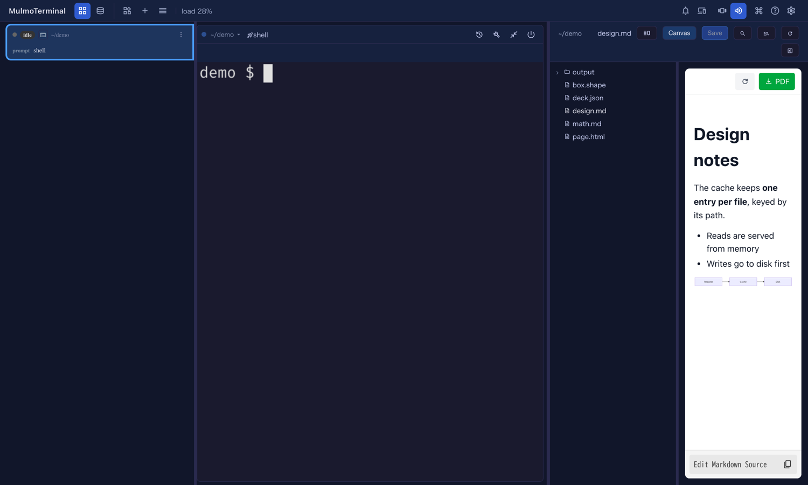
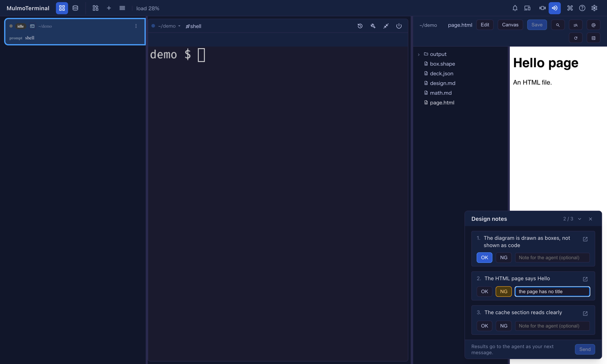

# The agent drives your right pane
{: .no_toc }

An agent working in a cell can use the **right pane** of that cell, the same pane you open with the
Files button. It can do two things there:

- **Show you a file** (`showInPane`). It opens a file in the Files pane, in the view it chooses and at
  the line it chooses. You see the change it just made instead of reading a description of it.
- **Ask you to check its work** (`requestCheck`). It puts a checklist over the terminal. Each item opens
  its file in one click, you mark it **OK** or **NG** with an optional note, and **Send** hands every
  answer back to the agent as your next message. The agent can then fix what was NG.

Both are for the moments where a person has to look: a UI change, a rendered document, a diagram, an
output the agent cannot judge by itself.

1. TOC
{:toc}

## Turning it on

The two tools belong to the **Canvas** tool group (`render`), the same group as `presentDocument` and
`presentChart`. Whoever already has the Canvas tools has these two as well:

- **In the workspace**, a Claude, Codex or Copilot cell has every GUI tool already. Nothing to do.
- **In a project directory**, switch on **Canvas** in the launcher's MCP toggles before you start the
  session. The toggle registers the directory, so it reaches the **next** session started there, not one
  that is already running.
- **Antigravity, Grok, Muse and Cursor** get GUI tools only by registering them, in the workspace too.
  See [Which coding agent](agents.html).

A session that was already running before you updated MulmoTerminal does not have the tools. Start a new
one.

You do not have to name the tools. Each tool tells the agent when to use it, so asking in plain words is
enough. See [What to ask for](#what-to-ask-for) below.

## Showing a file: `showInPane`



The agent names a file and, optionally, how to show it:

| The agent asks for | What you see |
|---|---|
| `editor` (the default) | The file's source in the editor. |
| `preview` | The rendered file: Markdown, HTML, CSV as a table. |
| `canvas` | The view the Canvas draws the file with: Markdown, HTML, MulmoScript, ShapeScript. |
| `split` | For Markdown, the editor on the left and the Canvas view on the right. |
| a line number | The editor, scrolled to that line, whatever view was asked for. |

The Files pane opens on its own if it was closed, with the file tree beside it as usual. If you had
unsaved edits in the pane, they are saved first. If the save fails, the pane stays as it was and nothing
is lost.

The file must be inside the cell's working directory. A path outside it is refused, and the agent is told
so. The Files pane must also be showing that directory: if you have pointed the pane somewhere else, the
file is not opened there.

## Asking you to check: `requestCheck`



The agent writes a short title and a list of items, up to twenty. Each item is one thing to look at and
what counts as right ("The formula is drawn, not shown as `$…$`"), and can name a file to open.

A card appears at the bottom right of the enlarged cell:

1. **Open** (the arrow icon on an item) shows that item's file in the pane, in the view the agent chose.
   The card stays where it is, so you can go through the items one by one.
2. Press **OK** or **NG** for each item. A note is optional. Write what is wrong when you press NG, so
   the agent knows what to fix.
3. **Send** becomes active once every item has an answer. It types the results into the terminal as one
   line, as if you had typed it yourself, and the card goes away.

The agent reads that line as your next message and carries on. A line looks like this:

```
Check results for "Design notes" (1 NG): 1. OK: The diagram is drawn 2. NG: The HTML page says Hello — the page has no title
```

Other things you can do with the card:

- **Fold** it (the chevron) to see the terminal underneath. Your answers stay.
- **Close** it (the cross) to put it away without sending. The agent gets nothing, so tell it yourself
  if you want it to stop waiting.
- A newer checklist from the same agent replaces the old one.
- Reload the page, or lose the connection, and the card comes back with the same items.

The agent does not wait for you. It ends its turn after posting the checklist. Your results arrive as a
new message, whenever you send them.

## When the agent's cell is not the one on screen

- **Another cell is enlarged:** nothing on your screen changes. The file or the checklist waits, and
  appears when you enlarge the agent's cell.
- **Nothing is enlarged** (the tiled grid): the agent's cell is enlarged for you, and the file or the
  checklist is shown there.
- **You are on another page**, such as Settings: no cell is enlarged for you. The request is there when
  you come back to the agent's cell.

## What to ask for

Ask in plain words. The tool descriptions do the rest. Some examples:

- "Show me the file you just changed." The agent opens it, at the line it changed.
- "Open the README in the Canvas view." The agent asks for `canvas`.
- "When you are done, give me a checklist to confirm the new page works." The agent ends with a
  `requestCheck`. Each item points at what to look at, and your NG notes become its next task.
- "Check the slides with me one by one." Each slide or file becomes an item.

The loop that works well: the agent changes something, posts a checklist, you mark it, it fixes the NGs
and posts a new checklist for just what it changed.

## Limits

- Only files inside the cell's working directory.
- Up to twenty items per checklist, and an item's label is cut at a few hundred characters.
- The card appears over an **enlarged** cell only. In the tiled grid there is no room for it, which is
  why the cell is enlarged for you.
- Results are typed as **one line**. Line breaks in your notes become spaces, since a line break would
  send the message early. Control characters are removed.
- The agent can only reach **its own** cell's pane, never another cell's.

More: [Feature reference](features.html) · [Feature list](feature-list.html)
