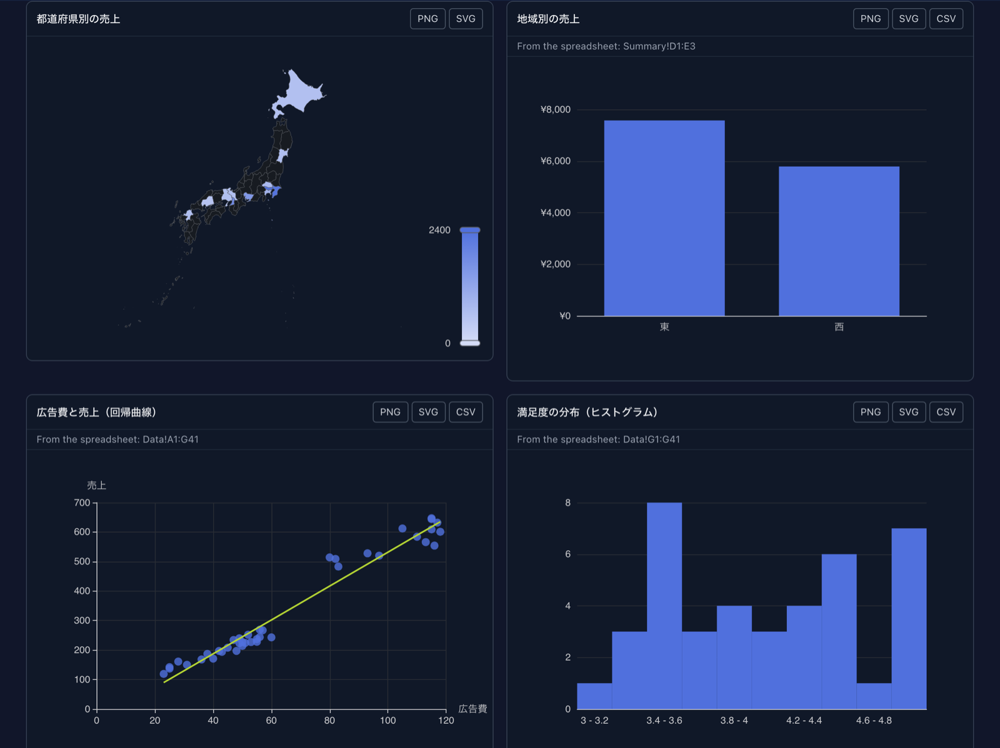
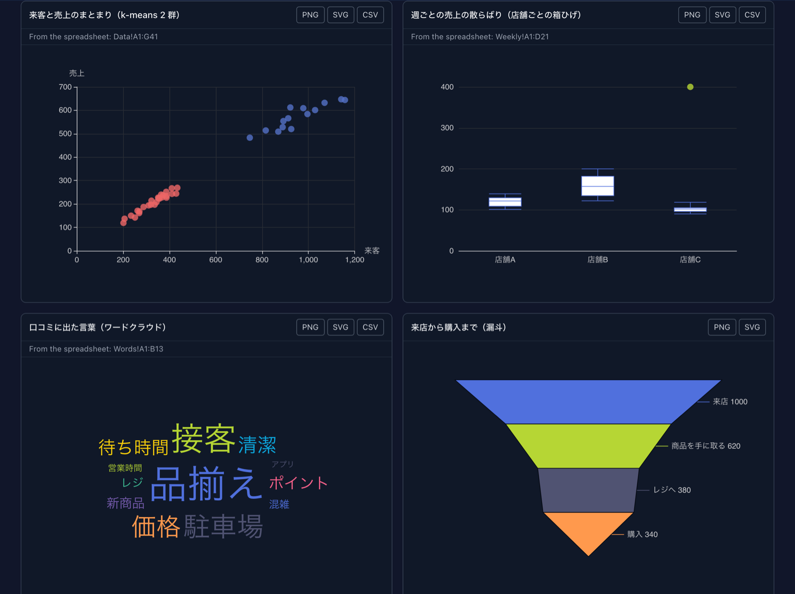
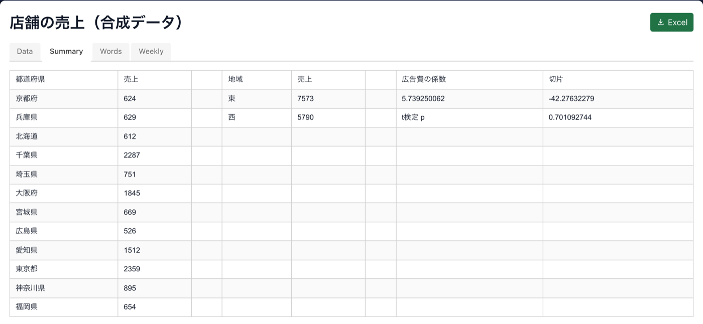

# Spreadsheets, charts and data analysis in conversation
{: .no_toc }

An agent working in a cell can put a **spreadsheet** on the Canvas beside its terminal. The sheet has
real formulas, so when you change a number the totals, averages and percentages recalculate at once. It
can also draw a **chart** of the same data. You keep talking to the agent in the terminal, and it can
read back what you changed.

Because the agent runs in your terminal, it can get the data itself: a CSV in your project, your git
history, a log file, a command's output. It works the numbers out with the shell and puts the result in
front of you as a table and a chart.

1. TOC
{:toc}

## Turning it on

The spreadsheet (`presentSpreadsheet`) and the chart (`presentChart`) belong to the **Canvas** tool
group (`render`):

- **In the workspace**, a Claude, Codex or Copilot cell has every GUI tool already. Nothing to do.
- **In a project directory**, switch on **Canvas** in the launcher's MCP toggles before you start the
  session. The toggle registers the directory, so it reaches the **next** session started there, not one
  that is already running.
- **Antigravity, Grok, Muse and Cursor** get GUI tools only by registering them, in the workspace too.
  See [Which coding agent](agents.html).

You do not have to name the tools. Ask in plain words ("put this in a spreadsheet", "chart it"). See
[What to ask for](#what-to-ask-for).

## What you get

**A spreadsheet with formulas.** The agent writes each total, average or percentage as a formula, not
as a number it worked out. Change a value and everything that depends on it changes with it.

- **Several sheets** in one spreadsheet, as tabs. A formula can refer to another sheet
  (`=Sales!D7`), so an "Assumptions" or "What-if" tab can feed the main one.
- **Number formats**: thousands separators, currency, percentages, dates.
- **Excel** (top right) downloads the spreadsheet as an `.xlsx` file.

**A chart.** `presentChart` draws charts with ECharts: line, bar, area, scatter, pie, heatmap,
candlestick, sankey and more. Several charts can be shown together. **PNG** on each chart downloads it as
an image. As of chart plugin 4.2.0 the agent also knows how to write the charts an analysis asks for:
boxplots, Pareto charts, two value axes, waterfalls, a fitted line over a scatter, average lines and
calendar heatmaps among them. From 4.3.0 it can also fit a curve or bin a histogram from a sheet's raw
columns, so those charts follow the sheet too. From 4.4.0 it can group points into clusters, box each
column of a sheet, and colour a map of Japan or the world (prefecture and country names in Japanese
work too). From 4.5.0 it can draw a word cloud, each word sized by its value. Cards follow a dark theme, can sit side by side, and also download as **SVG** and **CSV**.
If a chart cannot be drawn, the agent is told why and fixes it before anything is shown.

**What it looks like.** These cards were drawn from one spreadsheet of made-up store sales, after
requests like these:

> Show sales by prefecture on a map of Japan, and by region.
>
> How does advertising spend relate to sales? Draw the fitted line, and show how the satisfaction
> scores are spread.
>
> Which stores are alike? Box each store's weekly sales, make a word cloud of the words in the reviews,
> and a funnel from visit to purchase.

The Canvas was enlarged with the button at its top right, which is what puts the cards two to a row.
**From the spreadsheet:** under a title names the range a card is drawn from; edit the sheet and the
card is drawn again. The map here was drawn from values the agent wrote into the chart: a map drawn
from a sheet range does not colour its regions by value yet.

The totals behind those cards are formulas that answer a table: `=GROUPBY(Data!B2:B41, Data!E2:E41, SUM, 0, 0)`
fills one row per prefecture, `LINEST` puts the slope and intercept of the fit beside them, and `T.TEST`
compares the east with the west (see [Functions you can use](#functions-you-can-use)).

**A chart can follow the spreadsheet.** When the agent draws a chart from a range of the sheet, the
chart shows that range calculated, and draws itself again when the sheet is saved: change a number and
the chart moves with it. The card says which range it comes from ("From the spreadsheet: Summary!A1:C13").
A chart the agent drew from numbers it passed directly (a curve its script worked out, say) does not follow the
sheet; ask the agent to draw it again (see [Changing the numbers yourself](#changing-the-numbers-yourself)).
[Analysing data from start to finish](#analysing-data-from-start-to-finish) shows it working.

## Opening a CSV as a spreadsheet {#open-csv-as-spreadsheet}

In the Files pane beside a cell, right-click a `.csv` or `.tsv` file and choose **Open as a
spreadsheet (copy)**. The file becomes a spreadsheet on that cell's Canvas, without asking the agent:
one sheet named `Data`, the file's rows as they are, its first row included.

- It is a **copy**, saved under `artifacts/spreadsheets/`. Editing it never changes the CSV.
- A field that is a plain number (`1200`, `-3.5`) becomes a number, so formulas and charts can use
  it. Anything else stays the text the file holds, `1,200` and dates included.
- A date stays text too, but date functions (`YEAR(A2)`, `DATEDIF`, `EOMONTH`) read `2025-01-15`,
  `2025-01`, `Jan 2025` and `2025年1月` as dates. A month alone is its first day.
- A field that starts with `=` stays text, with a `'` in front, rather than running as a formula.
- Up to 5,000 rows. A larger file is refused with a note: ask the agent to analyse it instead, and
  it aggregates the file (see [A large file](#analysis-large-file)).
- The pane's own Canvas button and the full-screen Files view do not offer it: the copy goes on the
  Canvas of the cell beside the pane.

## Changing the numbers yourself

1. **Click a cell.** A bar opens at the bottom of the spreadsheet with the cell's name (`C7`).
2. Choose **String** for plain text, or **Formula** for a number or a formula. For a formula, start
   with `=`, for example `=SUM(B2:B7)`. The second box is the format, for example `#,##0` or `0.0%`.
3. Press **Update** (or Enter). The sheet recalculates, and the change is **saved** at once.
4. Close the bar with the cross.

To change a lot at once, open **Edit Spreadsheet Data** under the sheet. It shows the whole spreadsheet
as JSON. Edit it and press **Apply Changes**.

The Canvas beside a cell is narrow. When you edit, widen it with the expand button at the top of the
Canvas, so the edit bar fits.

### Letting the agent see what you changed

The agent is not told when you edit. Tell it, in the terminal:

> I changed the September pastry figure in the spreadsheet. Read it again and redraw the chart.

When the agent creates a spreadsheet, it is told where the file is saved and that you may edit it. Ask
it to read the sheet again, and it reads that file. The agent is given the file's full path, so this
works in a project directory too.

The file holds what you typed, **formulas included, not the results**. So the agent sees `=B7+C7`, not
`749,000`. To use a result, it works the formula out itself. For a long or intricate sheet, ask it to
compute the numbers with a script, rather than in its head.

## Analysing data from start to finish {#analysing-data-from-start-to-finish}

Hand the agent a CSV, TSV or Excel file and say what you want to know. You write no code and do not reshape the data:
the agent reads the file with a Node script, works out the statistics, and puts a live spreadsheet
and charts on the Canvas. The bundled `mulmoterminal-data-analysis` skill carries the procedure.
You do not have to name it.

### How to ask {#analysis-how-to-ask}

Name the file and what you want to compare:

> Analyse data/cafe-sales.csv. I want to see how temperature and the day of the week affect sales.

> Read orders.csv and compare the regions by month. Which region grew fastest?

> Look at survey.tsv: does satisfaction depend on age group?

A plain question works too. The answer comes with the spreadsheet and charts behind it:

> Can we say B did better than A in ab_test.csv?

Some things that help:

- **Say what you want to compare** (temperature against sales, weekdays against weekends). The agent
  picks the statistics and charts from that.
- **Clear column names help.** If a column's meaning is unclear (`amt`, `v2`), the agent asks once
  rather than guessing. Answer in a word.
- **Any delimited text works**: CSV, TSV, an export from another tool. So does an Excel file
  (`.xlsx`); the agent says which worksheets it has and which one it read. A large file is fine. The
  agent reads only its first lines into the conversation and lets a script read the rest.

### What the agent does {#analysis-steps}

1. **Checks the data first** and tells you: the number of rows, each column and whether it holds
   numbers, dates or categories, and how many values are empty or unreadable. Duplicate rows,
   missing dates and values far outside the rest come before anything interesting.
2. **Computes the statistics with a script** (`simple-statistics` in Node), so no number comes from
   the model reading the data.
3. **Builds the spreadsheet** with the statistics as formulas (below), and checks each formula
   against the script's number before showing it. If the Canvas reports a formula that calculates to
   an error, the agent fixes it before telling you the spreadsheet is ready.
4. **Draws charts from the spreadsheet**, so they follow it.
5. **Tells you what it found, and where everything is.**

### What you get {#analysis-what-you-get}

**A spreadsheet with one tab per question.** The raw data goes on a `Data` tab, and each analysis
gets a tab that reads it with formulas. For the cafe example, that is `Temperature` (correlation and
trend against temperature), `Weekday` (averages by day, weekdays against weekends) and `Stats`
(average, median, standard deviation, quartiles, minimum and maximum of each column).

**The statistics are formulas**, not numbers typed in: `=CORREL(Data!$C$2:$C$62,Data!$E$2:$E$62)`,
`=AVERAGEIF(Data!$B$2:$B$62,"Sat",Data!$D$2:$D$62)`, `=QUARTILE(Data!$C$2:$C$62,1)`. So they
recalculate when you change the data. See [Functions you can use](#functions-you-can-use) for what
the sheet can compute.

**Some results are values**, because no function gives them: a t-test, a non-linear fit. They are
labelled as computed (for example "t value (computed)") and do not change when you edit the data.
The agent tells you which ones they are.

**Charts drawn from the sheet.** Each card says which range it comes from:

The series names come from the range's header row, and the categories from its first column. In the
example, the regression line is drawn from a column of predicted values that is itself a formula,
so the line moves with the data too. A chart that is not drawn from the sheet (a curve its script worked out, say) has no
"From the spreadsheet" line, and the agent tells you it does not follow the sheet.

### Change the data and watch {#analysis-change-and-watch}

Click a cell, type a new value in the bar at the bottom and press **Update**. Here the iced drinks
sold on 1 June, a cool day at 18°C, are changed from 15 to 110:

Every formula that reads the cell recalculates at once, and the charts drawn from the sheet redraw
within a few seconds. Before the change:

After it:

The correlation fell from 0.91 to 0.74 and the line flattened, because one cool day now sold as much
as the hottest. This is the way to ask "what if": change a number, and see how much the conclusion
depends on it.

### Asking the agent to read it again {#analysis-read-again}

You do not need to tell the agent about an edit for the sheet and its charts to update; they do it
themselves. Tell it when you want its **interpretation** of the new numbers:

> I changed the iced drinks on 1 June. Read the spreadsheet again: what changed most?

The agent reads the file, works the formulas out with a script and tells you what moved. If the
sheet holds computed values (like the t value) or charts that do not follow it, those are now out
of date, and the agent recomputes them and **presents the spreadsheet again as a new one**. From
then on, edit the new one: the old one stays as it was and is no longer part of the analysis.

### Where it is saved {#analysis-files}

The agent ends by giving the paths:

| What | Where |
|---|---|
| The spreadsheet | `<workspace>/artifacts/spreadsheets/YYYY/MM/<id>.json` |
| The charts | `<workspace>/artifacts/charts/YYYY/MM/<name>.chart.json` |
| The scripts it used | `<workspace>/artifacts/analysis/YYYY/MM/<spreadsheet id>/` |

The scripts are kept so the analysis can be run again, for example on next month's CSV. Ask:

> Run the same analysis on data/cafe-sales-august.csv.

Nothing is written into your repository, and nothing is installed into your project: the agent
works in a temporary directory of its own.

### A large file {#analysis-large-file}

Up to about 5,000 rows, every row goes onto the Data sheet. A larger file (a year of orders, a log)
is **aggregated first**, and the sheet gets the aggregated table: sales per store, orders per
month, and so on. Formulas and charts then work on that table exactly as above. A large Excel file
is aggregated by a script.

In the workspace, or in a project where **Workspace data** is switched on, the agent makes a CSV or
TSV a read-only **collection** and lets the collection add it up. It reads the whole file, however
large, without loading it into the conversation:

> Analyse data/sales-2025.csv. It has a row per order; I want sales by store and by month.

What changes from a small file:

- The agent tells you the collection's name. It also appears in Collections, and it reads the
  file, so replacing the file updates it. The file has to be inside the workspace (or the project);
  if it is elsewhere, the agent asks before copying it into `data/`, and never overwrites a file
  already there. It picks a collection name that is not taken.
- Before trusting the collection's totals, the agent reads the file once in pieces to count its
  records and the values that are empty or not plain numbers. A collection leaves a value such as
  `1,200` (with a thousands separator) out of a sum, so when the file has any, the agent adds it up
  with a script instead and tells you how many values it had to convert or skip. The same goes for
  the smallest and largest value, which a collection compares as text in such a column.
- The Data sheet is labelled as aggregated (for example "Store (aggregated from sales-2025.csv)").
  Its numbers are values: editing the CSV does not change them until you ask for the analysis
  again. Formulas over them (totals, shares, correlation between the aggregated columns) still
  recalculate when you edit the sheet.
- Statistics that need every individual row, such as the median of all orders, are computed by a
  script that reads the file in pieces, or are stated as being over the aggregated table.

In a project cell without Workspace data, the agent aggregates the file with a script that reads it
in pieces. The result on the sheet is the same; switching Workspace data on is optional.

### Keep the analysis as a skill {#analysis-keep-as-skill}

When an analysis is what you wanted, the agent offers to keep it as a skill of your own, so the
next file of the same kind gets the same spreadsheet and charts from one request:

> Yes, keep it. Call it cafe-sales-check.

It asks where the skill should live:

- **for every terminal**: your user skills directory (for Claude Code `~/.claude/skills/`, or
  `$CLAUDE_CONFIG_DIR/skills/` when you have set `CLAUDE_CONFIG_DIR`);
- **for this project only**: `.claude/skills/` in the working directory.

The skill holds the scripts, rewritten to take any file of that shape (the file name is an argument;
row counts, ranges and everything else derived from the rows are computed from the data), and a
description naming the columns it needs. No row of your data goes into the skill. The agent
runs it once on the file you analysed and checks it gives the same result before handing it over.

Next month, in a new session:

> Analyse data/cafe-sales-august.csv with cafe-sales-check.

or `/cafe-sales-check data/cafe-sales-august.csv`. If the file lacks a column the skill needs, it
stops and says which, rather than guessing. A skill is read when a session starts, so start a new
one after making it. Skill names never start with `mulmoterminal-`, which belongs to the skills
MulmoTerminal ships.

## Where the files are

| What | Where |
|---|---|
| Spreadsheets | `<workspace>/artifacts/spreadsheets/YYYY/MM/<id>.json` |
| Charts | `<workspace>/artifacts/charts/YYYY/MM/<name>.chart.json` |
| Analysis scripts | `<workspace>/artifacts/analysis/YYYY/MM/<spreadsheet id>/` |

The workspace is `~/mulmoclaude` unless you have set `CLAUDE_CWD`. These are plain JSON files. Back them
up or keep them in git like any other file.

## Functions you can use

These are the functions you will reach for most, as of `@gui-chat-plugin/spreadsheet` 5.0.0; the package's
[README](https://www.npmjs.com/package/@gui-chat-plugin/spreadsheet) has the complete list. A function on neither
shows `#NAME?` in its cell, unless the spreadsheet defines it itself (see
[Functions of your own](#workbook-functions)).

| Kind | Functions |
|---|---|
| Totals and groups | `SUM` `AVERAGE` `MIN` `MAX` `COUNT` `COUNTA` `COUNTIF` `COUNTIFS` `SUMIF` `SUMIFS` `AVERAGEIF` `AVERAGEIFS` `MAXIFS` `MINIFS` |
| Spread and position | `MEDIAN` `MODE` `STDEV` `STDEVP` `VAR` `VARP` `PERCENTILE` `QUARTILE` `PERCENTRANK` `LARGE` `SMALL` `RANK` `SKEW` `KURT` `STANDARDIZE` `GEOMEAN` `HARMEAN` |
| Two columns | `CORREL` `PEARSON` `SLOPE` `INTERCEPT` `RSQ` `STEYX` `COVARIANCE.S` `COVARIANCE.P` `FORECAST` `FORECAST.LINEAR` `TREND` |
| Tests and distributions | `T.TEST` `TTEST` `T.DIST` `T.DIST.2T` `T.DIST.RT` `T.INV` `T.INV.2T` `NORM.DIST` `NORM.S.DIST` `NORM.INV` `NORM.S.INV` `CONFIDENCE.T` `CONFIDENCE.NORM` `CHISQ.TEST` `F.TEST` `Z.TEST` `ANOVA.TEST` `MANNWHITNEY.TEST` `WILCOXON.TEST` `KS.TEST` `SHAPIRO.TEST` `SPEARMAN` `KENDALL` |
| Fits and time series | `LINEST` `LOGEST` `GROWTH` `FREQUENCY` `FORECAST.ETS` `EMA` `DECOMPOSE` `AUTOCORREL` |
| Maths | `ROUND` `ROUNDUP` `ROUNDDOWN` `FLOOR` `CEILING` `INT` `TRUNC` `ABS` `SIGN` `POWER` `SQRT` `MOD` `PI` `EXP` `LN` `LOG` `LOG10` `SUMPRODUCT` `MMULT` `MINVERSE` `RAND` `RANDBETWEEN` `RANDARRAY` |
| Logic | `IF` `IFS` `AND` `OR` `NOT` `IFERROR` `IFNA` `TRUE` `FALSE` |
| Names and LAMBDA | `LET` `LAMBDA` `MAP` `BYROW` `BYCOL` `REDUCE` |
| Lookup | `VLOOKUP` `HLOOKUP` `XLOOKUP` `XMATCH` `INDEX` `MATCH` `ROW` `COLUMN` `ROWS` `COLUMNS` |
| Tables from a formula | `FILTER` `SORT` `SORTBY` `UNIQUE` `GROUPBY` `PIVOTBY` `TAKE` `DROP` `CHOOSECOLS` `CHOOSEROWS` `HSTACK` `VSTACK` `TRANSPOSE` `SEQUENCE` |
| Text | `CONCATENATE` `CONCAT` `LEFT` `RIGHT` `MID` `LEN` `UPPER` `LOWER` `PROPER` `TRIM` `SUBSTITUTE` `REPLACE` `FIND` `SEARCH` `TEXT` `VALUE` `EXACT` |
| Dates and times | `TODAY` `NOW` `DATE` `TIME` `YEAR` `MONTH` `DAY` `HOUR` `MINUTE` `SECOND` `WEEKDAY` `DAYS` `DATEDIF` `EDATE` `EOMONTH` `WORKDAY` `NETWORKDAYS` |
| Finance | `PMT` `PV` `FV` `NPV` `IRR` `RATE` `NPER` `IPMT` `PPMT` |

`STDEV` and `VAR` are the sample versions (divide by n-1); `STDEVP` and `VARP` divide by n. The current Excel
names work too: `STDEV.S`, `STDEV.P`, `VAR.S`, `VAR.P`, `PERCENTILE.INC`, `QUARTILE.INC`, `PERCENTRANK.INC`,
`RANK.EQ`. `PERCENTILE` and `QUARTILE` interpolate the way Excel's `.INC` versions do, and the `.EXC` versions
are there too.

A formula with no number format shows a date only when its number comes from a date (a date function, or a
date cell), so a total of 52,345 stays a number.

Date formats are read the way Excel reads them, both in a cell's format and in `TEXT`: `yyyy-mm-dd`,
`yyyy"年"m"月"d"日"`, `h:mm AM/PM` and the like, in either case. `TEXT(A2,"yyyy-mm")` gives `2025-01` for a date, and
also for a date written as text.

**A formula can answer a table.** `=SORT(UNIQUE(A2:A100))`, `=GROUPBY(A2:A100,B2:B100,SUM)` or plain
`=Data!A1:C10` fills the cells to the right and below it, as in Excel 365; if one of them already holds
something, the formula shows `#SPILL!`. Other formulas, and charts drawn from the sheet, read those cells like
any others. Only the formula is saved. A whole column such as `A:A` works as a range.

`RAND`, `RANDBETWEEN` and `RANDARRAY` give the same numbers every time the sheet is calculated, unlike Excel, so
the agent and you see the same table.

### Functions of your own {#workbook-functions}

For a method no function above has (a moving average, a weighted score), the agent can define a function in
the spreadsheet itself and use it in formulas like any other:

> Add a 7-day moving average column, as a function of the spreadsheet so it updates.

The agent writes `MOVING.AVG` into the spreadsheet and fills the column with `=MOVING.AVG(B$2:B8, 7)` and so
on. Edit a sales figure and the average recalculates, as a formula does. The function is saved with the
spreadsheet, so it is still there when the file is opened again, and charts drawn from the sheet use it too.

It runs sealed off: it sees only the cells it is given, with no access to files, the network or the screen,
and a call that runs longer than 50 ms stops with `#NUM!`. A mistake in it shows `#VALUE!` in the cell.

## What to ask for

Ask in plain words. Some ways of working that come from the agent having a shell beside the Canvas:

### A file in your project, as a table and a chart

> Read sales.csv, put it in a spreadsheet with monthly totals and the change from last month, and chart
> the trend.

The agent reads the file, builds the sheet with formulas, and draws the chart. The screenshots on this
page are this request. It works for any data the agent can read: CSV, JSON, a log, an export from
another tool.

### Analyse a CSV from start to finish

> Analyse data/cafe-sales.csv. I want to see how temperature and the day of the week affect sales.

The bundled `mulmoterminal-data-analysis` skill takes it from there. See
[Analysing data from start to finish](#analysing-data-from-start-to-finish) for what you get and how
to work with it.

### Your own repository

> Count commits per week for the last three months from git log, by top-level directory, and show it
> as a spreadsheet and a stacked bar chart.

> Run the test suite with timing, and put the twenty slowest test files in a spreadsheet with their
> share of the total.

The agent runs the commands, sums the output, and shows you the result. Nothing has to be exported by
hand first.

### Change the assumptions, then ask again

> Make a three-year plan for the café: an Assumptions tab with price, cups per day, growth and costs,
> and a Plan tab that uses them.

Change a growth rate or a price yourself and watch the plan recalculate. When you have a version you
like, ask:

> I changed the assumptions. Read the spreadsheet again, tell me what moved most, and redraw the chart.

### Statistics the sheet does not have

> Fit a curve to these sales and put the fitted parameters in the spreadsheet.

Correlation, regression, t-tests, distributions, percentiles and ranks are formulas now (see
[Functions you can use](#functions-you-can-use)), and a method none of them gives can be a
[function of the spreadsheet's own](#workbook-functions). What is left — a result that needs data
outside the spreadsheet, or a computation too heavy for a cell — the agent works out with a script in
the terminal and puts in as a value. Values from a script do not recalculate when you edit the sheet;
formulas do.

### Have the numbers checked

> When the report is ready, give me a checklist to confirm the totals.

The agent posts a checklist (`requestCheck`, see [The agent drives your right pane](pane-tools.html)).
Mark each line OK or NG, and your notes come back as the agent's next task.

## Limits

- The spreadsheet's buttons and labels are in English.
- Only the functions in [Functions you can use](#functions-you-can-use). Anything else is `#NAME?`.
- The saved file holds formulas, not their results. The agent has to work the results out.
- A chart follows the spreadsheet only when the agent drew it from a range of the sheet. Ask for any other chart to be drawn again.
- The agent is not told about your edits. Tell it in the terminal.
- A file above about 5,000 rows is shown aggregated, not row by row (see [A large file](#analysis-large-file)).

More: [Feature reference](features.html) · [The agent drives your right pane](pane-tools.html)
