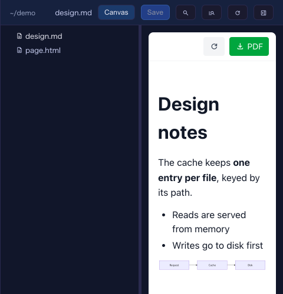

# 10.1.0 — Switch a file to the Canvas view inside the Files pane

**A snapshot as of 10.1.0 (released 2026-10-12).** It will go stale as the app moves on — that is
expected, and the living reference is the guide each section links to.

## New features

### The Canvas view opens inside the Files pane, with the tree kept beside it

Before, pressing **Canvas** in the Files pane replaced the whole right pane with the cell's Canvas. Closing the
Canvas then closed the file tree as well, and you had to start again from **Browse files in the app**. Now the
**Canvas** button switches the open file to the Canvas view *in place*: the tree stays on the left, and pressing
**Canvas** again goes back to the editor
([#3009](https://github.com/receptron/mulmoterminal/pull/3009),
[#3008](https://github.com/receptron/mulmoterminal/issues/3008)).

To try it:

1. Enlarge a terminal and open its files (the folder button in the cell header, or **Browse files in the app**
   from the path menu).
2. Open a Markdown, HTML or MulmoScript file.
3. Press **Canvas** in the pane's header. The file is drawn the way the Canvas draws it — diagrams, maths and
   all — while the tree stays where it was. Right-click a row and choose **Open in the Canvas** to do the same
   for another file.
4. Press **Canvas** again to go back to the editor.

What to expect:

- Unsaved edits are saved first. If someone else changed the file meanwhile, the usual conflict banner appears
  and the view does not switch.
- Nothing is added to the cell's own Canvas: what you look at here is yours, not the agent's.
- It is the pane beside a cell only. The full-screen file view keeps **Preview**.

More: [Feature reference](features.html).

### The Canvas view is remembered

A file you left in the Canvas view comes back in the Canvas view after you close and reopen the pane, or reload
the page — the same way Preview has always been remembered
([#3013](https://github.com/receptron/mulmoterminal/pull/3013),
[#3011](https://github.com/receptron/mulmoterminal/issues/3011)). If you opened the pane by clicking a path in
the terminal, that file comes up as text, and the remembered Canvas views are not restored that one time.

Nothing to configure.

### Cmd/Ctrl+click on a terminal path opens a new tab

Hold **Cmd** (macOS) or **Ctrl** (Windows / Linux) while clicking a file path in terminal output, and the file
opens in a new tab of the Files pane, keeping the tab you were on. A plain click still replaces the front tab
([#3007](https://github.com/receptron/mulmoterminal/pull/3007),
[#3005](https://github.com/receptron/mulmoterminal/issues/3005)).

More: [Feature reference](features.html).

## What looks different

- **The Files pane's Canvas button stays pressed** while the file is in the Canvas view, and the editor-only
  buttons (Edit/Preview, Changes, history, outline, @) step aside until you switch back.
- **Pressing Canvas in the Files pane no longer turns the right pane into the Canvas**, so closing it no longer
  takes the tree away.

## Under the hood

- **A path with a line number shows the line.** Clicking `design.md:42` in the terminal on a file that is in the
  Canvas view now opens it on the editor at line 42, as it already did for Preview; a click with no line keeps
  the Canvas view ([#3012](https://github.com/receptron/mulmoterminal/pull/3012),
  [#3010](https://github.com/receptron/mulmoterminal/issues/3010)).
- **The 10.0.0 page has its screenshot** of the phone's past-sessions list
  ([#3006](https://github.com/receptron/mulmoterminal/pull/3006)).
- Nothing else needs doing.
