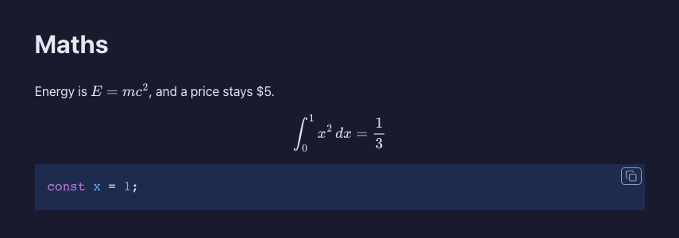
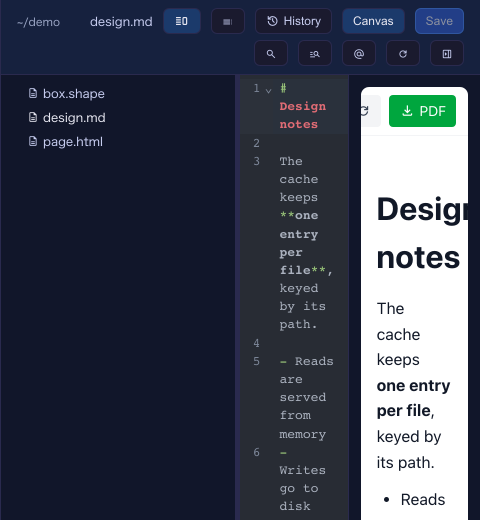
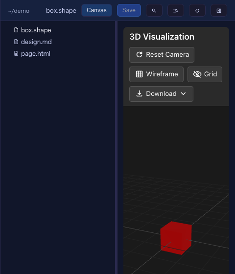

# 10.2.0 — Maths in the full-screen preview, ShapeScript and the editor beside the Canvas view

**A snapshot as of 10.2.0 (released 2026-10-12).** It will go stale as the app moves on — that is
expected, and the living reference is the guide each section links to.

## New features

### Maths in the full-screen preview

The full-screen file view (`/files`) used to show `$…$` and `$$…$$` as code in a Markdown file's
**Preview**. It now draws them, in the app's colours, inline and on their own line
([#3021](https://github.com/receptron/mulmoterminal/pull/3021),
[#3017](https://github.com/receptron/mulmoterminal/issues/3017)).

To try it: open a `.md` with a formula in the full-screen file view and press **Preview**. A price like
`$5` stays text, and so does anything inside code. The same file opened in a new tab shows the maths too.

Nothing to configure. More: [Feature reference](features.html).

### The editor beside the Canvas view

For a Markdown file, the side-by-side button (the split icon in the Files pane's header) now puts the
editor beside the **Canvas** view as well as beside Preview. The **Canvas** button decides which one is on
the right ([#3020](https://github.com/receptron/mulmoterminal/pull/3020),
[#3015](https://github.com/receptron/mulmoterminal/issues/3015)).

To try it: open a `.md` in the Files pane, press the split icon, then **Canvas**. Save in the editor
(Cmd+S) and the right side redraws. Press the split icon again to keep only the Canvas view.

More: [Feature reference](features.html).

### ShapeScript files open in the Canvas view

`.shape` files join Markdown, HTML and MulmoScript: open one in the Files pane and press **Canvas** to
see the 3D model beside the tree
([#3019](https://github.com/receptron/mulmoterminal/pull/3019),
[#3016](https://github.com/receptron/mulmoterminal/issues/3016)).

Nothing to configure.

## What looks different

- **In the Canvas view of a Markdown file, the split icon stays in the header** (Edit/Preview steps
  aside), since it is how the editor comes back beside the view.
- **Formulas in the full-screen preview** are drawn rather than shown as `$…$`.

## Under the hood

- **Maths is typeset on the server** with MathJax, so the preview stays the script-free page it was. What
  reaches the page is filtered to the elements and attributes MathJax itself writes, so a formula cannot
  carry a link, a style or markup into the preview.
- Nothing needs doing.
