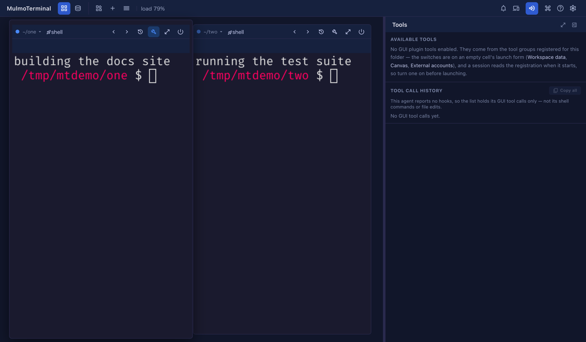

# 10.4.0 — Panes beside the tiled grid, and files outside the cell open in a tab

**A snapshot as of 10.4.0 (released 2026-10-13).** It will go stale as the app moves on — that is
expected, and the living reference is the guide each section links to.

## New features

### Open a pane without enlarging the cell

The panes in a cell's **History** and **Tools** menus — Prompts, Conversation, Tools, Canvas, Collections,
and Files from the path menu's *Browse files in the app* — used to need the cell enlarged first. On a
tiled cell they were greyed out with "Enlarge the cell to open this beside it". Now they open **to the
right of the tiled grid**, and every tile stays on screen
([#3029](https://github.com/receptron/mulmoterminal/pull/3029),
[#3027](https://github.com/receptron/mulmoterminal/issues/3027)).

To try it: with nothing enlarged, open a tile's **Tools** menu (the wrench in its header) and pick
**Tools**. The pane appears on the right; drag the divider to make it wider or narrower.

What to expect:

- The pane shows **the tile whose menu opened it**. Clicking or typing in another tile does not move it;
  opening a pane from another tile's menu does.
- Picking the same entry again on that tile closes it.
- Enlarge a cell and the pane comes along beside it; restore the cell and it goes back beside the tiles.
- In the tiled grid the pane never takes the full width, the Conversation pane included. That is still
  there beside an enlarged cell.
- If the pane's tile is on another page of the grid, the pane is hidden until you come back to that
  page. Anything open in it, unsaved edits included, is kept.
- A file path clicked in a terminal opens in the Files pane here too, when the Files pane is already up
  beside the tiles and the file is in that tile's directory.

What still enlarges the cell: an agent's drawing, a question the agent asks you, and a file or checklist
the agent puts in the pane. Those open by themselves only beside an enlarged cell, as before.

More: [Basics](basics.html).

### A video, image, PDF, sound or page outside the cell opens in a tab

Clicking a terminal path to a video, an image, a PDF, an audio file or an HTML page that lives **outside
the cell's own directory** used to open a tab that said
`{"error":"cwd is not an active session directory"}`. Now the file opens in that tab
([#3028](https://github.com/receptron/mulmoterminal/pull/3028),
[#3024](https://github.com/receptron/mulmoterminal/issues/3024)).

To try it: in any terminal, print an absolute path to an image somewhere else on your disk
(`echo ~/Pictures/photo.png`) and click it.

- The tab can show **that file only**. An HTML page that links to an image beside it shows the page
  without that image.
- If the file has gone, the tab says so.
- Markdown, JSON, tables and source files outside the cell open as they did before.

More: [Feature reference](features.html).

### Closing a checklist tells the agent

When an agent puts a checklist in front of you (new in 10.3.0) and you close it with the cross instead of
pressing **Send**, the terminal now gets one line: `Check "<title>" was closed without answers.` An agent
that was told to wait for your answers no longer waits for a message that never comes
([#3026](https://github.com/receptron/mulmoterminal/pull/3026),
[#3025](https://github.com/receptron/mulmoterminal/issues/3025)).

More: [The agent drives your right pane](pane-tools.html).

## What looks different

- **The History and Tools menus on a tile** no longer grey out their panes with "Enlarge the cell to open
  this beside it". Every entry can be picked.
- **The grid gets narrower** while a pane is open beside it, to make room.

## Under the hood

- The command palette's **Files pane** entry and the `pane-*` keys open the pane beside the tiled grid
  too, instead of enlarging the cell first.
- A file outside the cell is served through a one-time link for that single file, made only when you
  click. It lasts until the server restarts.
- Nothing needs doing.
