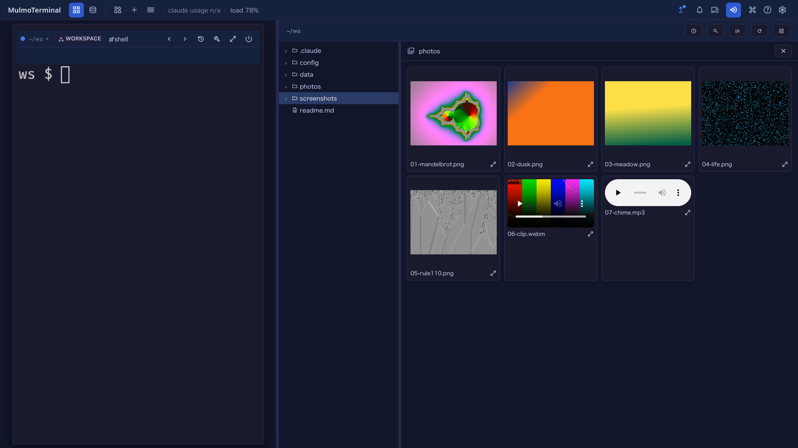

# 10.9.0 — Spreadsheets on the Canvas, and a folder as a gallery

**A snapshot as of 10.9.0 (released 2026-10-19).** It will go stale as the app moves on — that is
expected, and the living reference is the guide each section links to.

## New features

### Spreadsheets with live formulas on the Canvas

An agent can now put a **spreadsheet** on the Canvas beside its terminal
([#3078](https://github.com/receptron/mulmoterminal/pull/3078),
[#3076](https://github.com/receptron/mulmoterminal/issues/3076)). Totals, averages and percentages are
real formulas, so when you change a number in a cell everything that depends on it recalculates at
once. Several sheets sit in one spreadsheet as tabs, and **Excel** at the top right downloads it as an
`.xlsx` file.

To try it, ask in plain words: "put this month's numbers in a spreadsheet", "chart it".

- **In the workspace**, a Claude, Codex or Copilot cell can do it already.
- **In a project directory**, switch on **Canvas** in the launcher's MCP toggles, then start a new
  session there.

When you have changed some numbers, ask the agent to read the sheet again. It sees what you changed.

More: [Spreadsheets, charts and data analysis in conversation](spreadsheet.html), including the
functions you can use.

### Analyse a CSV: `/mulmoterminal-data-analysis`

A new bundled skill takes a CSV or TSV from start to finish
([#3093](https://github.com/receptron/mulmoterminal/pull/3093),
[#3091](https://github.com/receptron/mulmoterminal/issues/3091)):

> /mulmoterminal-data-analysis orders.csv

It checks the columns and the empty values, works out summary statistics, shows a spreadsheet and
charts that fit the data, and says where everything was saved. Its scripts go in
`<workspace>/artifacts/analysis/`, never in your repository. "Analyse orders.csv" is usually enough;
you do not have to name the skill.

If you edit the sheet and ask it to read it again, the recalculated sheet comes back as a **new**
spreadsheet ([#3095](https://github.com/receptron/mulmoterminal/pull/3095)). Edit that one from then on.

More: [Analyse a CSV from start to finish](spreadsheet.html#analyse-a-csv-from-start-to-finish).

### A folder as a gallery in the Files pane

Right-click a folder in the Files tree and choose **Open as gallery**
([#3081](https://github.com/receptron/mulmoterminal/pull/3081),
[#3079](https://github.com/receptron/mulmoterminal/issues/3079)). That folder's pictures, videos, sounds
and PDFs appear together, in name order (`2.png` before `10.png`).

- Videos and sounds play inside their tile. Starting one stops the other.
- Click a tile to see it large. **←** / **→** move through the folder, **Esc** goes back to the
  tiles, and **Esc** again closes the gallery.
- Only that folder's own files are shown, not its subfolders. A large folder shows the first page of
  tiles, and **Show more** adds the next.
- Opening a file closes the gallery.

More: [Feature reference](features.html).

## What looks different

- **Preview and Canvas carry to the next file**
  ([#3077](https://github.com/receptron/mulmoterminal/pull/3077),
  [#3075](https://github.com/receptron/mulmoterminal/issues/3075)). In the Files pane beside a cell, if
  you read a Markdown file in Preview and then open another one, it now opens in Preview too, instead of
  the editor. This is remembered per session and survives a reload. A file you had already set to
  another view keeps its own. The full-screen Files view is unchanged.

## Under the hood

- **A model can no longer make a screen-only save through a tool call**
  ([#3082](https://github.com/receptron/mulmoterminal/pull/3082),
  [#3080](https://github.com/receptron/mulmoterminal/issues/3080)). Saving from the HTML, ShapeScript or
  spreadsheet view on screen works as before; nothing needs doing.
- **An agent in a project directory can read the file a spreadsheet or chart was saved to**
  ([#3085](https://github.com/receptron/mulmoterminal/pull/3085),
  [#3084](https://github.com/receptron/mulmoterminal/issues/3084)). The tool's reply now gives the full
  path. Before, asking "read the sheet and tell me the total" failed in a project cell.
- **The spreadsheet plugin is at 4.0.2**
  ([#3089](https://github.com/receptron/mulmoterminal/pull/3089)): `=LOG10(100)` shows `2` instead of
  `#ERROR!`.
- **The guide has a page for spreadsheets and charts**
  ([#3088](https://github.com/receptron/mulmoterminal/pull/3088),
  [#3086](https://github.com/receptron/mulmoterminal/issues/3086)).
- **The Files pane's code was split into smaller pieces**
  ([#3087](https://github.com/receptron/mulmoterminal/pull/3087),
  [#3083](https://github.com/receptron/mulmoterminal/issues/3083)). It looks and behaves as before.
