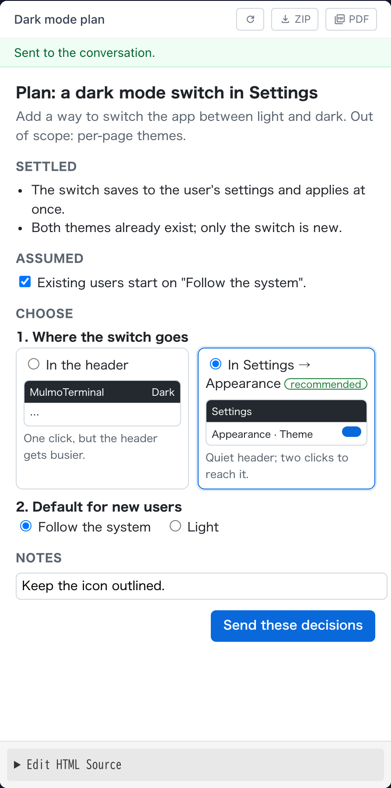

# 11.3.0 — Decide a plan on a page

**A snapshot as of 11.3.0 (released 2026-10-22).** It will go stale as the app moves on — that is
expected, and the living reference is the guide each section links to.

## New features

### Decide a plan on a page

Ask the agent for a plan you can look at instead of a wall of text
([#3163](https://github.com/receptron/mulmoterminal/pull/3163),
[#3168](https://github.com/receptron/mulmoterminal/pull/3168)). For example:

> Plan this change as HTML.

The bundled `mulmoterminal-html-plan` skill lays the plan out as a page in the Canvas, the pane on
the right of the terminal: what is settled, what the agent assumed (with a box to untick when it got
that wrong), and each open choice as small mockups or controls you can try side by side. Pick, adjust,
type a note, and press the button at the bottom of the page. A short **Sent to the conversation**
appears, and your decisions arrive in the terminal as your next message — the agent carries on from
there.

If the Canvas is not open, the cell's header shows a pencil button with a count; press it, or open
the cell's Tools menu (the wrench) and choose **Canvas**.

More: [Features](features.html).

### Edit a video by asking

Ask the agent to cut a part out, join clips, change the speed, even out or replace the sound, make
it vertical, add subtitles made from what is said, or put a title on screen
([#3160](https://github.com/receptron/mulmoterminal/pull/3160)). The bundled
`mulmoterminal-video-edit` skill does it with `ffmpeg` (`brew install ffmpeg`); subtitles from speech
also need `whisper-cli` (`brew install whisper-cpp`). The original is never changed: the result is a
new file beside it, opened in the pane.

More: [Features](features.html).

## What looks different

- A page that is not the agent's own plan page — one it opened from a file, for example — shows a
  bar above it with exactly what would be sent when its button is pressed; it is sent only when you
  press **Send** in that bar
  ([#3163](https://github.com/receptron/mulmoterminal/pull/3163)).
- Word clouds are drawn by a dedicated word-cloud library: they can take a shape (a circle, a star,
  a diamond and others) and export to PNG, but no longer to SVG
  ([#3164](https://github.com/receptron/mulmoterminal/pull/3164),
  [#3165](https://github.com/receptron/mulmoterminal/pull/3165)).
- The spreadsheet guide shows what the charts and the table-answering formulas look like
  ([#3161](https://github.com/receptron/mulmoterminal/pull/3161)).

## Under the hood

### Chart fixes

A map drawn from a sheet range no longer paints the regions with no data as if they were the
largest, and the labels of a 3D chart read on the dark theme
([#3164](https://github.com/receptron/mulmoterminal/pull/3164)). Nothing to do.

### Updated libraries

The chart, HTML page and core libraries were updated
([#3164](https://github.com/receptron/mulmoterminal/pull/3164),
[#3165](https://github.com/receptron/mulmoterminal/pull/3165),
[#3168](https://github.com/receptron/mulmoterminal/pull/3168)). If you run MulmoTerminal from a
clone, run `yarn install` after pulling, or the plan page's button falls back to the bar.
