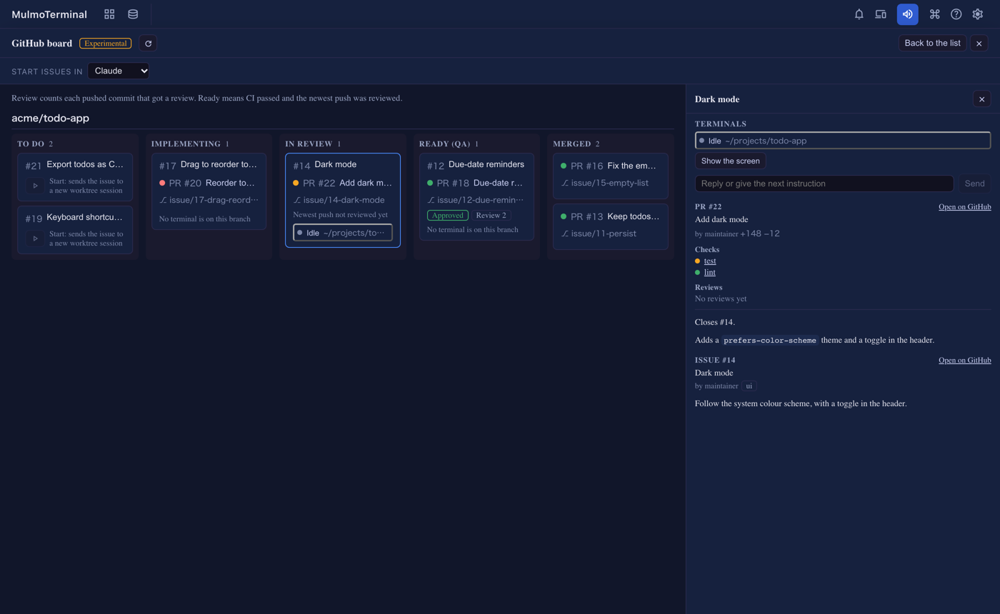
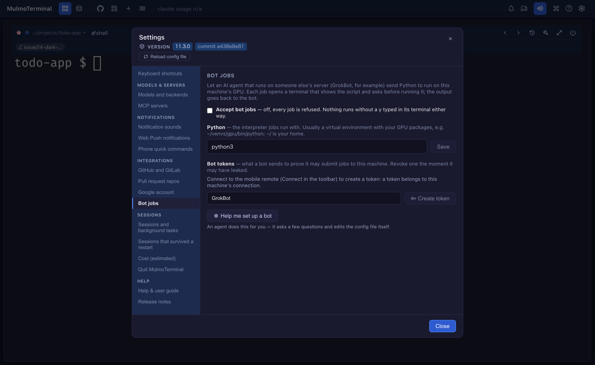

# 11.4.0 — A board for your issues and PRs

**A snapshot as of 11.4.0 (released 2026-10-26).** It will go stale as the app moves on — that is
expected, and the living reference is the guide each section links to.

## New features

### The GitHub board (experimental)

Open the GitHub view (the toolbar's **Pull requests** button, the GitHub mark) and press **Open the board
(experimental)**
([#3175](https://github.com/receptron/mulmoterminal/pull/3175)). For each repository under
Settings → **Pull request repos**, every piece of work becomes one card in one of five columns:
**To do**, **Implementing**, **In review**, **Ready (QA)** and **Merged**. A card joins the issue,
the pull request that closes it, its branch, and the terminals open on that branch.

Where a card sits:

- **Implementing** — a draft, a failed CI or changes requested, or a branch with a terminal on it
  and no pull request yet.
- **In review** — CI is still running, or the newest push has not been reviewed. **Review 2** on a
  card means two pushed commits got a review.
- **Ready (QA)** — CI passed and the newest push was reviewed (or the pull request is approved).

Press a card to open its details on the right: its terminals, the pull request's checks and reviews
and description, and the issue's labels and description. **Open on GitHub** is inside the panel
([#3178](https://github.com/receptron/mulmoterminal/pull/3178)).

**Start an issue from the board.** A To do card has a start button. It cuts the issue's worktree,
starts the agent picked in **Start issues in**, and sends the issue text at once — the new terminal
joins the grid behind the board, and the card moves to Implementing
([#3181](https://github.com/receptron/mulmoterminal/pull/3181)). On the `/github` list the issue
text is still left for you to send, as before.

**Answer a terminal from the board.** Each terminal in the detail panel has **Show the screen**
and a box, **Reply or give the next instruction**, which types one line and presses Enter
([#3187](https://github.com/receptron/mulmoterminal/pull/3187)). Whatever you had already typed in
that terminal stays. When a Claude terminal asks a question with options and the question pane is
switched on, the options show as buttons. A permission prompt (1. Yes / 2. No) still needs keys, so
open the terminal for that.

**It keeps itself current** ([#3183](https://github.com/receptron/mulmoterminal/pull/3183)). A
terminal's state (working, waiting, idle) changes live, and a card with a terminal waiting for you
gets an amber border and **Waiting for you**. The board reads GitHub again every minute while it is
on screen, and a few seconds after one of its terminals finishes a turn. If a read fails, the cards
stay and the error shows above them.

GitHub repositories only, and it needs `gh` signed in, like the list. More:
[GitHub](github.html).

### Let a remote bot run a Python job here

An AI agent that runs on someone else's server (GrokBot, for example) can now send a Python script
to run on this machine — on its GPU, say — and get the output back
([#3184](https://github.com/receptron/mulmoterminal/pull/3184),
[#3192](https://github.com/receptron/mulmoterminal/pull/3192)). **Nothing runs without you**: each
job opens a terminal that shows the script and the exact command line, and asks
`Run this job? [y/N]`. Only a typed `y` runs it.

To set it up, open Settings → Integrations → **Bot jobs**:

1. Tick **Accept bot jobs**. It is off until you do, and every job is refused.
2. In **Python**, give the interpreter the jobs run with — usually a virtual environment that has your
   GPU packages, such as `~/venvs/gpu/bin/python` — and press **Save**.
3. Connect the mobile remote (**Connect** in the toolbar). A token belongs to this machine's
   connection, so **Create token** stays greyed out until then.
4. Name the bot and press **Create token**. The secret is shown **once**, with a copy button and the
   two addresses to give the bot. Copy it then; it cannot be shown again.

Not sure which Python has the right packages? **Help me set up a bot** starts an agent that finds it
and fills the settings in for you. Revoke a token from the same list the moment it may have leaked.

The job terminal opens even when no browser tab is open, and is kept alive until the job ends. More:
[Phone](phone.html).

## What looks different

- A shared plugin's screen — the Canvas page's confirmation bar and "Sent to the conversation",
  markdown, chart and others — now follows the app's display language instead of always showing
  English. Collections and accounting follow the language picked in the app too, rather than the
  browser's ([#3171](https://github.com/receptron/mulmoterminal/pull/3171)).
- If you open MulmoTerminal from another machine by a name or address that is not configured, every
  request is now refused with a `403` that names the setting to add, instead of the page loading and
  no terminal attaching ([#3191](https://github.com/receptron/mulmoterminal/pull/3191)). See
  [Under the hood](#server-name).

## Under the hood

### Emoji and wide characters line up

A row with an emoji, a flag, a skin tone, a family or a Korean syllable could show the rest of the
row shifted a column in the browser, because the browser and tmux counted that character's width
differently. MulmoTerminal now measures how the running tmux counts each one when the server
starts, and the browser counts the same way
([#3174](https://github.com/receptron/mulmoterminal/pull/3174)). A tab opened before the
measurement ended is updated and redrawn when it arrives
([#3186](https://github.com/receptron/mulmoterminal/pull/3186),
[#3190](https://github.com/receptron/mulmoterminal/pull/3190)). On Windows the same is done for
psmux ([#3193](https://github.com/receptron/mulmoterminal/pull/3193)), and a very long run of
joined characters now wraps where tmux wraps it
([#3195](https://github.com/receptron/mulmoterminal/pull/3195)). Nothing to do; a terminal that
was already misaligned lines up after the server restarts.

### A name the server answers to {#server-name}

Every request has to be addressed to `localhost` or a name you configured in `MULMOTERMINAL_HOST` or
`MULMOTERMINAL_ALLOWED_ORIGINS` ([#3191](https://github.com/receptron/mulmoterminal/pull/3191)).
This stops a web page from reading MulmoTerminal through a DNS trick (DNS rebinding). Opening it on
the same machine, or through a tunnel to `localhost`, changes nothing. If you bind to `0.0.0.0` and
open it by a LAN address, add that address to `MULMOTERMINAL_ALLOWED_ORIGINS`. More:
[Configuration](config.html#bind-host).

### psmux uses less memory

On Windows with psmux 3.3.1 or later, psmux's pool of spare shells is turned off, in new and
running servers alike ([#3169](https://github.com/receptron/mulmoterminal/pull/3169)). No cell ever
used a spare, so they only held memory and restarted on every resize. Nothing to do.

### Updated libraries

The jinglescript plugin, the spreadsheet plugin, the Gemini and MCP libraries and others were
updated ([#3176](https://github.com/receptron/mulmoterminal/pull/3176)). If you run MulmoTerminal
from a clone, run `yarn install` after pulling.
