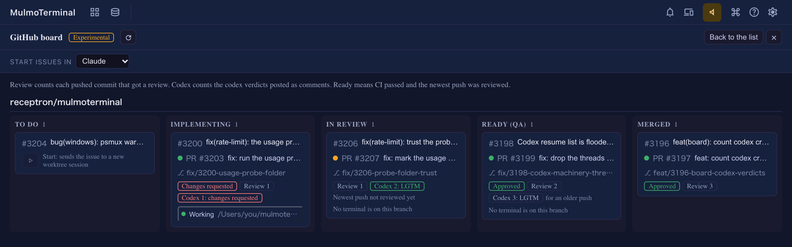

# 11.5.0 — The usage gauge works wherever you start

**A snapshot as of 11.5.0 (released 2026-10-28).** It will go stale as the app moves on — that is
expected, and the living reference is the guide each section links to.

## New features

### The latest Codex verdict on a board card

On the experimental GitHub board (the toolbar's GitHub mark, then **Open the board (experimental)**),
a pull request whose thread holds a `CODEX VERDICT:` comment — the kind the `codex-cross-review`
loop posts — now shows it on its card as **Codex 2: LGTM** or **Codex 2: changes requested**, the
number counting the verdicts so far
([#3197](https://github.com/receptron/mulmoterminal/pull/3197)).

The chip is **green or red only when the verdict names the push that is on the branch now** — a
verdict line reads `CODEX VERDICT: LGTM (head <sha>)`, and that sha has to match. A verdict about an
earlier push is drawn muted with **for an older push** beside it; one that names no push says
**push not named**. Only verdicts by the repository's owner, members and collaborators count, and a
merged card shows no chip. The review round and the columns are as they were. Nothing to set up:
open the board and look at an open pull request that has had a Codex round. More:
[GitHub](github.html).

## What looks different

- **The Codex resume list no longer shows untitled "Guardian review" rows**
  ([#3199](https://github.com/receptron/mulmoterminal/pull/3199)). Codex keeps the reviews it runs
  on its own tool calls, and its memory consolidation, as conversations of their own in the same
  folder, and the launcher's "resume a codex conversation here" list showed them. It now lists only
  conversations a person started. How to tell: in a folder where you have used Codex, open the
  launcher and look at the resume list — the rows with no title are gone.
- **On Windows with psmux 3.4.0, a new cell no longer opens with a config warning**
  ([#3205](https://github.com/receptron/mulmoterminal/pull/3205)). The first line of every cell used
  to read `psmux: 1 config warning(s): … unknown option 'terminal-features'`. That line was tmux's
  way of forwarding clickable links, which psmux does without being told; it is now left out of
  psmux's configuration. Restart the server once and open a new cell: the line is gone.
- **The usage gauge's hover text names a folder.** When the Claude figures are missing because the
  check is waiting on Claude Code's trust prompt, the text now says which folder to run `claude` in
  ([#3203](https://github.com/receptron/mulmoterminal/pull/3203)). With 11.5.0 you should rarely see
  it at all — see [Under the hood](#usage-probe).

  

## Under the hood

### The Claude usage gauge works from any folder, home included {#usage-probe}

**What was broken.** The 5h / 7d Claude figures in the grid header come from a hidden `claude`
session that asks one tiny question. It used to run in the workspace — the folder you started
`npx mulmoterminal` in. Started in your home directory, that folder is the one Claude Code never
saves trust for, so the hidden session stopped at the "Do you trust this folder?" dialog every time,
the header showed `claude usage n/a`, and accepting the prompt as the hover text suggested changed
nothing ([#3200](https://github.com/receptron/mulmoterminal/issues/3200)).

**What changed.** The check now runs in a folder of MulmoTerminal's own, `~/.mulmoterminal/probe`,
wherever you started MulmoTerminal ([#3203](https://github.com/receptron/mulmoterminal/pull/3203)).
And because nobody would ever run `claude` there by hand, MulmoTerminal records the trust answer for
that folder itself, in Claude Code's own settings for the login the check runs on — your usual login,
and each [second subscription](accounts.html) — before the first check
([#3207](https://github.com/receptron/mulmoterminal/pull/3207)). The folder is empty and belongs to
MulmoTerminal, so trusting it lets Claude Code read nothing it would not read anyway. The entry is
written once; if Claude Code's own save happens to overwrite it, the next check writes it again.

**Nothing to do.** How to tell you have the fix: start MulmoTerminal from your home directory, open
the grid, and within a minute or two the Claude `5h` / `7d` figures appear in the header. If the
header still says `claude usage n/a` and the hover text names the trust prompt, the answer could not
be written — for a login that has never run `claude`, there is no settings file yet — so do once what
the text says: run `claude` in `~/.mulmoterminal/probe` (for a second subscription, start a cell on
that account with `~/.mulmoterminal/probe` as the **Working directory**) and accept the prompt. More:
[Configuration](config.html) under `usageGauge`, and [Second subscriptions](accounts.html).

### Windows: a Codex installed with npm starts in a psmux cell

On Windows with psmux, a new Codex cell could end at once with
`psmux: can't find session: mulmoterminal__mt-…` while a Claude cell on the same machine ran
([#3202](https://github.com/receptron/mulmoterminal/pull/3202)). The difference was how the two were
installed: `claude.exe` is a program psmux can start, while an npm-installed `codex` is a `.cmd`
script, which it cannot. MulmoTerminal now starts such a script through `cmd.exe` inside the psmux
pane, the way it already did without psmux. Nothing to do: a Codex cell opens and stays open.
