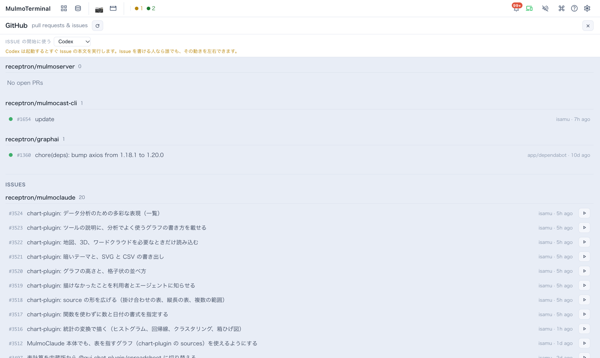

# GitHub — PR / Issue 横断ビュー
{: .no_toc }

- TOC
{:toc}

**複数のリポジトリにまたがる未マージの Pull Request と Issue を、1 画面でまとめて確認できます。**
どのリポで何がレビュー待ちか、CI が落ちていないかを、セッションを渡り歩かずに一望できます。
さらに Issue の行の **▶** を押すと、その Issue 用の worktree を作ってエージェントを起動するところまで 1 クリックで進みます。



## 画面の見方

上の画面を上から順に見ていきます。

| 場所 | 何があるか |
|---|---|
| **一番上の行** | タイトル「GitHub pull requests & issues」と **↻（再読み込み）** ボタン。右端の **✕** で閉じます（Esc でも閉じます） |
| **Issue の開始に使う** | ▶ を押したときに起動するエージェント（Claude / Codex など）を選ぶメニュー。Claude 以外を選ぶと、その下に黄色の注意書きが出ます（[理由](#start-from-issue)） |
| **PR の一覧** | 登録したリポジトリごとに、見出し（`owner/repo` と件数）と Open な PR が並びます。PR が無いリポは「No open PRs」 |
| **ISSUES** | 同じくリポジトリごとの Open な Issue |
| **行の左端の ●** | PR の CI の状態（緑＝成功 / 赤＝失敗 / 琥珀＝実行中 / 淡色＝チェックなし） |
| **行の右側** | 作者と最終更新（例 `isamu · 5h ago`） |
| **Issue の行の ▶** | この Issue に着手する。worktree を作り、エージェントをグリッドのセルとして起動します |

行そのもの（番号やタイトル）をクリックすると、**GitHub がブラウザの別タブで開きます**。

## 使い始めるまでの 3 ステップ

1. **サーバを動かすマシンで `gh auth login`** — このビューは裏で GitHub CLI（`gh`）を実行します。
   アプリはトークンを持たず、あなたの `gh` のログインをそのまま使います。
2. **見たいリポジトリを登録する** — **設定 → プルリクエストのリポジトリ**（英語表示では *Pull request repos*）に
   `owner/repo` を入れて追加します。[詳しく](#register)
3. **グリッドのツールバーの GitHub マーク（pull request）を押す** — このボタンは、リポジトリを 1 つ以上登録すると現れます。
   グリッドを表示している間だけ出る、グリッド用の操作の並びにあります。

あとは [Issue の行の ▶](#start-from-issue) から作業を始められます。

---

## 1. 見たいリポを登録する {#register}

表示されるのは**登録したリポだけ**です（worktree やセッションから自動では増えません）。
方法は 2 つあり、どちらも**すぐに反映されます**（再起動は要りません）。

### 設定画面から（おすすめ）

1. ツールバーの **設定 → プルリクエストのリポジトリ** を開きます。
2. 入力欄に **`owner/repo`**（例 `receptron/mulmoterminal`）を入れて追加します。
3. 追加したリポは一覧に並び、各行の **✕** で削除できます。

> 形式は `owner/repo` だけです（スペース・パス・`https://…` は使えません）。`gh --repo` にそのまま渡すため、
> `owner` と `repo` を `/` でつないだ素の名前だけが有効です。

### 設定ファイルを直接編集

`~/.mulmoterminal/config.json` の **`prRepos`**（`"owner/repo"` の配列）に書きます。

```json
{
  "prRepos": ["acme/web", "acme/api"]
}
```

GitLab のプロジェクトも書けます。→ [GitLab を使う](#gitlab)

→ キーの一覧は [設定方法](config.html) を参照。

## 2. ビューを開いて見る {#read-the-view}

- **PR が上、Issues が下**の 2 段です。どちらも **リポジトリごと**に見出し（`owner/repo` と件数）でまとまります。
- 表示されるのは **Open な項目だけ**。並び順は、リポは登録した順、項目は `gh` が返す順です。
- **行をクリックすると GitHub が別タブで開きます**（アプリ内では開きません）。
- **自動更新はしません**。開いたときに一度取得し、あとは **↻** を押したときだけ取り直します。

### PR の行に出る情報

| 表示 | 意味 |
|---|---|
| **● CI ドット** | 緑＝成功／赤＝失敗／琥珀＝実行中／淡色＝チェックなし |
| **#番号・タイトル** | PR 番号とタイトル |
| **draft** | 下書きの PR のとき |
| **approved / changes requested / review required** | レビューの状態 |
| **作者 · 相対時刻** | 例 `alice · 2h ago`（最終更新） |

Issue の行は **#番号・タイトル・作者 · 相対時刻** に加えて、右端に **▶（着手）** ボタンが出ます（次の節）。

> 1 リポあたり **PR は最大 100 件 / Issue は最大 20 件**まで。超えると「これ以上あります」の注記と
> GitHub へのリンクが出ます。

## 3. Issue の行から作業を始める {#start-from-issue}

行末の **▶** を押すと、作業の準備が 1 クリックで済みます。

1. Issue を読み（タイトルと本文）、
2. そのリポのクローンに **`issue/<番号>-<slug>` の worktree** を作り（fetch した `origin/<ベース>` から分岐）、
3. その worktree でエージェントを**グリッドのセルとして起動**します。Claude の場合、Issue の内容は**入力欄に入った状態**で、
   **送信はされていません**。読んで、必要なら直して、Enter は自分で押します。

### どのエージェントで始めるか

一覧の上の **Issue の開始に使う** で選びます。

- 初期値は Claude（`defaultAgent` を設定していればそれ）。選んだものはこのブラウザが覚えます。
- Claude と Codex は、[アカウント](config.html#accounts)を設定していれば隣の **アカウント** でログインも選べます。
- この環境にインストールされていないエージェントは、一覧に出ますが選べません。
- **Claude 以外は、起動するとすぐ Issue の本文を実行します**（下書きを置いておく入力欄がないため）。
  さらに Codex 以外はツールの使用も自動で承認します。そのため、それらを選んでいる間は黄色の注意書きが出続けます
  （上の画面で Codex を選んだときに出ているのがそれです）。
- セッションが既にある Issue は、この選択に関係なく、そのセッションを始めたときのエージェントとログインで再開します。

> Issue の本文は、その Issue を書いた**他人**のテキストであることがほとんどです。だから Claude では送信せず
> 入力欄に置いたままにしています。Enter を押すのはあなたです。**再開したセッション**には
> 何も入力されません — そのセッションには既に会話があるためです。

### 着手したあとに繋がるもの

ブランチが Issue 番号を持っているので、以降は何も指定しなくても繋がります。⧉ Open PR は
PR 本文に `Fixes #<番号>` を入れ、ヘッダーの作業項目チップ・Issue への作業コメント・
マージ時の自動クローズも同じ番号を読みます。

### こんなときは

- **同じリポのクローンを複数持っている** → 初回だけどれを使うか聞かれ、その答えを覚えます
  （設定の `repoDirs`）。次からは 1 クリックです。
- **そのリポのクローンが無い** → ボタンが無効になり理由が出ます。設定のディレクトリプリセットに登録すると使えるようになります。
- **同じ Issue をもう一度押した** → 2 本目の worktree は作りません。1 つの Issue に worktree は 1 つで、
  既にあるものが開き、そこにセッションが残っていればそれが開きます。
  そのセッションを**他のターミナルで開いたまま**なら、何も起こさずにその旨が出ます
  （[worktree は 1 セッションまで](worktree.html#one-session)、というルールと同じです）。

## GitLab を使う {#gitlab}

`prRepos` のエントリにはホストを付けて `"gitlab.com/group/project"` とも書けます。**GitLab のプロジェクトも読みます** —
GitHub に対する `gh` と同じ役割を `glab` が果たし、一覧・Issue からの着手・作業コメント・MR 作成が
すべて動きます。GitLab はグループがネストするので `gitlab.com/group/sub/project` も書けます。
ホストを省略すると github.com 扱いなので、既存の設定はそのままです。

**それ以外**のホストのエントリは、何も出さずに消えるのではなく**そのホスト名を挙げて**行に出ます。

1 点だけ違いがあります。**GitLab の行の CI ドットはたいてい空です** — MR 一覧にパイプラインの状態が
入っておらず、読むには MR ごとに 1 回の呼び出しが必要なためです。1 ブランチだけを見るセルは読むので、
コックピットの段階表示は正確です。

### 自前ホスティングの GitLab

`gitlab.example.com` はアドレスからは判別できません — そのホストで動いているのが GitLab なのか
Gitea なのか Wiki なのか、名前のどこにも書いていないからです。そこで、同じファイルで一度だけ宣言します。

```json
{
  "gitlabHosts": ["gitlab.example.com"],
  "prRepos": ["gitlab.example.com/group/project"]
}
```

ファイルを書き換えずに、**設定 → GitHub と GitLab → セルフホストの GitLab** からホストを足すこともできます。
足したらすぐに効き、再起動は要りません。

宣言したホストは **gitlab.com と完全に同じ**に振る舞います — 一覧・Issue からの着手・作業コメント・
MR 作成のすべてです。必要なのは 2 つだけ。

1. **そのホストに `glab` でログインしていること** — `glab auth login --hostname gitlab.example.com`。
   このアプリは自前のトークンを持たず、`gh` と同じくあなたの `glab` を実行します。
2. **`config.json` を手で書いたら、設定の「設定ファイルを読み直す」を押すかサーバを再起動する** — 手書きの `prRepos` と同じです（設定画面から足す場合は不要です）。

宣言する前は、その行が「未対応」ではなく**足すべきキー**を挙げて出ます。まだ対象外なのは、
ポート付きのホスト名 (`gitlab.example.com:8443`)、http のみのインスタンス、GitHub Enterprise です。

## 裏側のしくみ

- アプリはトークンを保存・参照しません。**`gh` のログイン権限**でそのまま見えます。
- リポは**必ずサーバ側の設定**から取得します（ブラウザからのリクエストでは受け取りません）。
- 各リポの取得は**並行**で、**失敗したリポだけ**そのエラーを表示します（他のリポは表示されます）。

## 見えないときは

- **ツールバーに GitHub マークが無い。** → リポがまだ 1 つも登録されていないか、グリッド以外の画面を表示しています。
- **「No repositories configured…」と出る。** → まだ登録がありません。**設定 → プルリクエストのリポジトリ** で `owner/repo` を追加。
- **「gh not found…」と出る。** → GitHub CLI を入れて `gh auth login`。
- **特定のリポだけエラー。** → 綴り（`owner/repo`）と、そのリポへの **`gh` のアクセス権**を確認。private なら権限が必要です。
- **さっき出した PR が出ない。** → 自動更新はないので **↻** を押します。それでも無ければ Open 状態か、`owner/repo` が正しいか確認。
- **件数が頭打ち。** → 1 リポ PR 100 / Issue 20 の上限です。全部は各行のリンクから GitHub で。

---

← [機能一覧](features.html) ／ [設定方法](config.html) ／ [日本語ガイドの目次](index.html)
