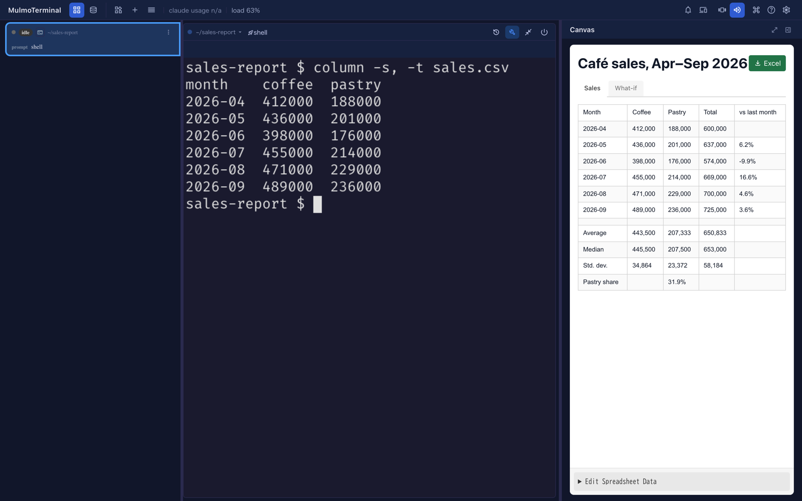
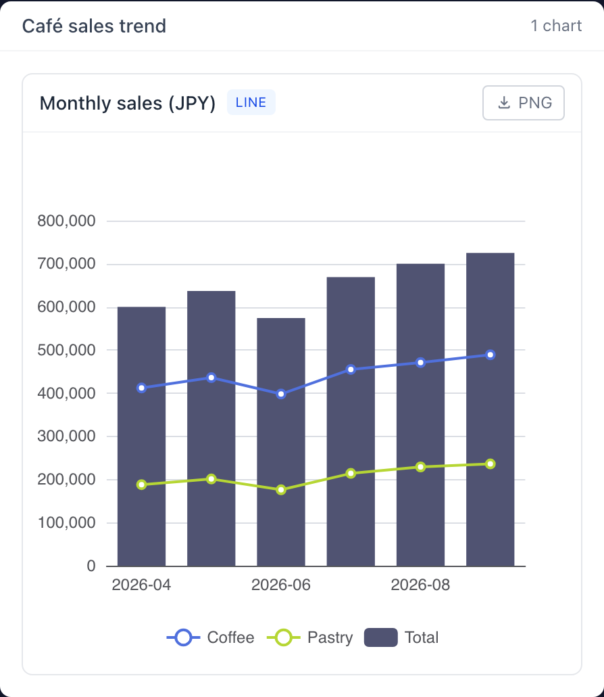
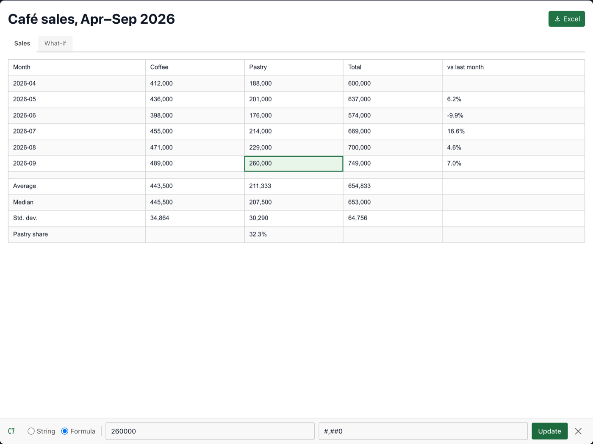
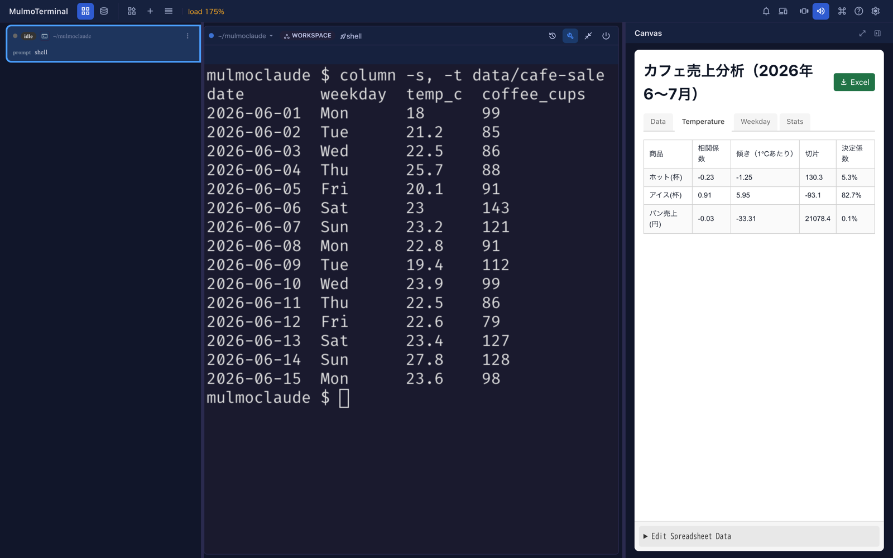
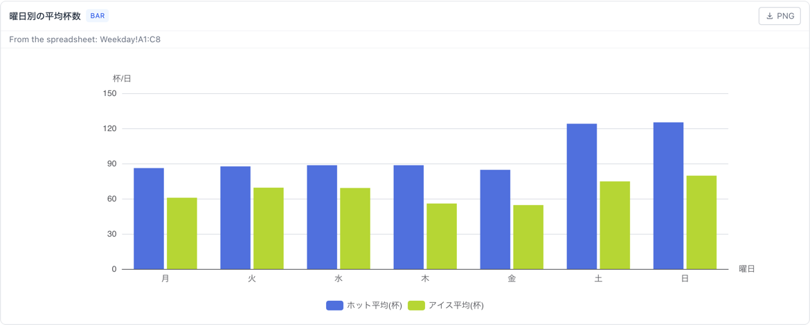
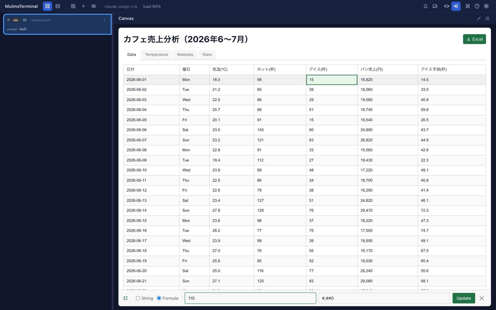
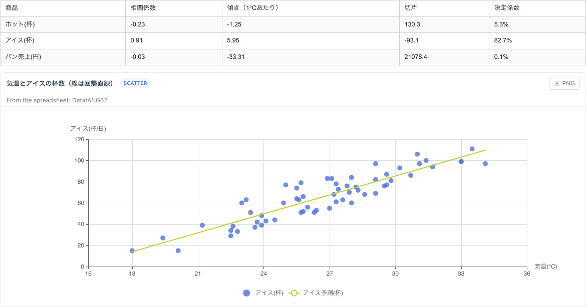
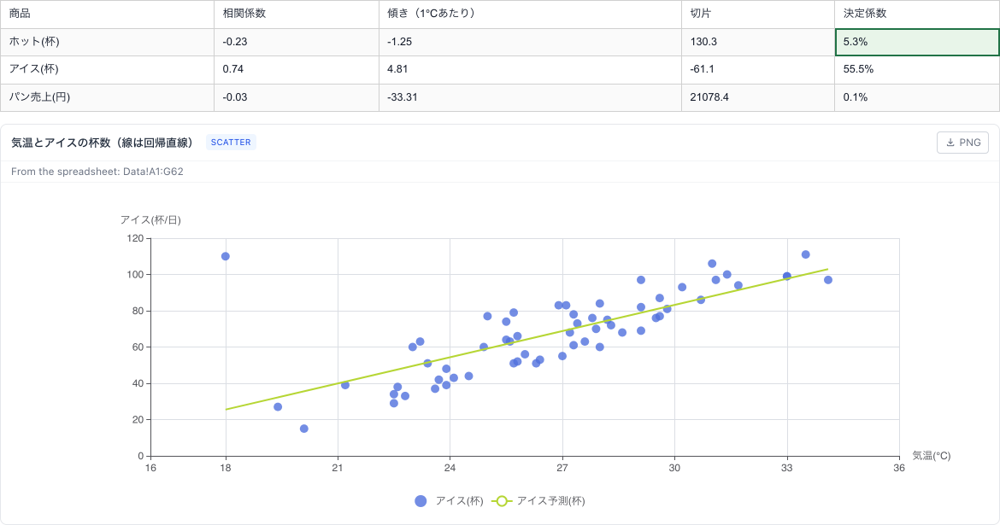

# 会話しながら表計算・グラフ・データ分析
{: .no_toc }

セルで動いているエージェントは、端末の横の Canvas に**表**を出せます。表には本物の計算式が入っているので、
数字を一つ直すと、合計・平均・割合がすぐに計算し直されます。同じデータから**グラフ**も描けます。
会話は端末でそのまま続けられ、エージェントはあなたが直した内容を読み返せます。

エージェントは端末の中で動いているので、データも自分で取ってきます。プロジェクトの CSV、git の履歴、
ログファイル、コマンドの出力など。シェルで集計して、結果を表とグラフにして見せてくれます。

1. TOC
{:toc}

## 有効にする

表（`presentSpreadsheet`）とグラフ（`presentChart`）は **Canvas** の道具（`render`）に入っています。

- **作業領域**の Claude・Codex・Copilot のセルは、最初から画面の道具を全部持っています。何もしなくて構いません。
- **プロジェクトのディレクトリ**では、セッションを始める前に、起動画面の MCP の切り替えで **Canvas** をオンにします。
  切り替えはディレクトリに登録されるので、効くのはそこで**次に**始めるセッションからです。動いているセッションには届きません。
- **Antigravity・Grok・Muse・Cursor** は、作業領域でも登録したときだけ画面の道具を使えます。
  [どのコーディングエージェントを使うか](agents.html)を見てください。

道具の名前を言う必要はありません。「表にして」「グラフにして」と普通に頼めば使われます。
[頼み方](#what-to-ask-for)を見てください。

## 何ができるか

**計算式の入った表。** エージェントは合計・平均・割合を、自分で計算した数字ではなく計算式として書きます。
値を一つ直すと、それに関わるところが全部変わります。

- 一つの表に**複数のシート**をタブで持てます。計算式から別のシートを参照でき（`=Sales!D7`）、
  「前提」や「試算」のタブの数字で本体のシートを動かせます。
- **数字の書式**：桁区切り、通貨、パーセント、日付。
- 右上の **Excel** で `.xlsx` ファイルとしてダウンロードできます。

**グラフ。** `presentChart` は ECharts でグラフを描きます。折れ線、棒、面、散布図、円、ヒートマップ、
ローソク足、サンキーなど。複数のグラフを並べることもできます。各グラフの **PNG** で画像として保存できます。

**グラフは表を追いかけられます。** エージェントが表の範囲からグラフを描くと、グラフはその範囲を計算した値で描かれ、
表が保存されるたびに描き直されます。数字を直せば、グラフも動きます。カードには、どの範囲から描いたかが出ます
（「From the spreadsheet: Summary!A1:C13」）。エージェントが数字を直接渡して描いたグラフ（ヒストグラムや当てはめた線など）は
表を追いかけないので、描き直しを頼んでください（[自分で数字を直す](#changing-the-numbers-yourself)）。
動いている様子は[データを最初から最後まで分析する](#analysing-data-from-start-to-finish)にあります。

## CSV を表計算で開く {#open-csv-as-spreadsheet}

セルの横のファイルのペインで、`.csv` か `.tsv` のファイルを右クリックし、**表計算で開く（コピー）** を選びます。エージェントに頼まずに、
そのセルの Canvas に表として出ます。シートは `Data` の 1 枚で、ファイルの行がそのまま（1 行目も含めて）入ります。

- **コピー**です。`artifacts/spreadsheets/` に保存され、表を直しても CSV は変わりません。
- ただの数（`1200`、`-3.5`）は数として入るので、計算式やグラフに使えます。それ以外（`1,200` や日付も）は、ファイルのままの文字です。
- `=` で始まる値は、計算式として動かないよう、先頭に `'` を付けた文字にします。
- 5,000 行まで。それより大きいファイルは、理由を出して開きません。エージェントに分析を頼むと、ファイルを集計します（[大きなファイル](#analysis-large-file)）。
- ペインの Canvas ボタンと、全画面のファイルの画面にはありません。コピーは、ペインの横のセルの Canvas に出ます。

## 自分で数字を直す {#changing-the-numbers-yourself}

1. **セルをクリック**します。表の下に、セルの名前（`C7`）の付いた編集欄が開きます。
2. ただの文字なら **String**、数字や計算式なら **Formula** を選びます。計算式は `=` で始めます（例：`=SUM(B2:B7)`）。
   二つ目の欄は書式です（例：`#,##0`、`0.0%`）。
3. **Update**（または Enter）を押すと、表が計算し直され、変更はすぐに**保存**されます。
4. 編集欄は右の × で閉じます。

まとめて直したいときは、表の下の **Edit Spreadsheet Data** を開きます。表全体が JSON で出るので、
直して **Apply Changes** を押します。

セルの横の Canvas は幅が狭いので、編集するときは Canvas の上の拡大ボタンで広げてください。編集欄が収まります。

### 直した内容をエージェントに見てもらう

あなたが表を直しても、エージェントには知らされません。端末で伝えてください。

> 表の 9 月のペストリーの数字を直した。読み直して、グラフも描き直して。

エージェントは表を作ったときに、保存先のファイルと、利用者が直すかもしれないことを伝えられています。
読み直してと頼めば、そのファイルを読みます。ファイルの場所はフルパスで渡されるので、プロジェクトのディレクトリでも読めます。

ファイルに入っているのは**入力した内容で、計算式はそのまま、計算結果は入っていません。** エージェントに見えるのは
`749,000` ではなく `=B7+C7` です。結果が必要なときは、エージェントが式を自分で計算します。
長い表や込み入った表なら、頭の中ではなくスクリプトで計算してもらってください。

## データを最初から最後まで分析する {#analysing-data-from-start-to-finish}

CSV・TSV・Excel のファイルを渡して、知りたいことを言うだけです。コードを書いたり、データの形を整えたりする必要はありません。
エージェントが Node のスクリプトでファイルを読み、統計を計算し、計算式の入った表とグラフを Canvas に出します。
手順は同梱の `mulmoterminal-data-analysis` スキルに入っています。スキルの名前を言う必要はありません。

### 頼み方 {#analysis-how-to-ask}

ファイルと、比べたいことを言います。

> data/cafe-sales.csv を分析して。気温と売上の関係、曜日による違いを見たい。

> orders.csv を読んで、地域ごとに月別で比べて。どの地域がいちばん伸びた？

> survey.tsv を見て。満足度は年代で違う？

ただの質問でも構いません。答えには、裏付けの表とグラフが付きます。

> ab_test.csv で、B のほうが良いと言っていい？

うまくいくこつ：

- **何と何を比べたいかを言う**（気温と売上、平日と週末など）。エージェントはそこから統計とグラフを選びます。
- **列の名前は分かりやすい方がよい。** 意味の分からない列（`amt`、`v2`）があると、エージェントは推測せずに一度だけ聞きます。一言で答えてください。
- **区切り文字のテキストなら何でも使えます**：CSV、TSV、ほかの道具から書き出したもの。Excel のファイル（`.xlsx`）も使えます。
  エージェントは、どんなシートがあって、どれを読んだかを伝えます。大きなファイルでも構いません。
  会話に読み込むのは先頭の数行だけで、残りはスクリプトが読みます。

### エージェントがすること {#analysis-steps}

1. **まずデータを確かめて伝える**：行の数、それぞれの列が数値・日付・分類のどれか、空や読めない値の数。
   重複した行、日付の抜け、ほかから大きく外れた値を、面白い発見より先に伝えます。
2. **統計をスクリプトで計算する**（Node の `simple-statistics`）。数字をモデルが読み取って書くことはありません。
3. **表を作る。** 統計は計算式で入れ（下を参照）、出す前にスクリプトの値と一致するかを確かめます。
   誤りになる計算式があると Canvas から知らされるので、直してから「できた」と伝えます。
4. **グラフを表から描く。** だから表を追いかけます。
5. **分かったことと、保存した場所を伝える。**

### 出てくるもの {#analysis-what-you-get}

**問いごとにシートが分かれた表。** 元のデータは `Data` のシートに入り、分析ごとのシートが計算式でそれを読みます。
カフェの例なら、`Temperature`（気温との相関と傾向）、`Weekday`（曜日別の平均、平日と週末の比較）、
`Stats`（各列の平均・中央値・標準偏差・四分位・最小・最大）です。

**統計は、打ち込んだ数字ではなく計算式です**：`=CORREL(Data!$C$2:$C$62,Data!$E$2:$E$62)`、
`=AVERAGEIF(Data!$B$2:$B$62,"Sat",Data!$D$2:$D$62)`、`=QUARTILE(Data!$C$2:$C$62,1)`。
だからデータを直すと計算し直されます。表で計算できる関数は[使える関数](#functions-you-can-use)を見てください。

**値で入る結果もあります。** t 検定や曲線の当てはめのように、関数で書けないものです。
「t値（計算済みの値）」のように計算済みと分かる名前が付き、データを直しても変わりません。どれがそうかは、エージェントが伝えます。

**表から描いたグラフ。** カードには、どの範囲から描いたかが出ます。

系列の名前は範囲の見出しの行から、分類は範囲の 1 列目から取られます。この例では、回帰直線を計算式で求めた予測値の列から描いているので、
線もデータと一緒に動きます。表から描いていないグラフ（ヒストグラムの区間など）には「From the spreadsheet」の行がなく、
表を追いかけないことをエージェントが伝えます。

### データを直して、変わるのを見る {#analysis-change-and-watch}

セルをクリックし、下の欄に新しい値を入れて **Update** を押します。ここでは、18℃ と涼しかった 6 月 1 日のアイスを
15 杯から 110 杯に直しています。

そのセルを読む計算式がすべてすぐに計算し直され、表から描いたグラフも数秒で描き直されます。直す前：

直した後：

涼しい日 1 日が、いちばん暑い日並みに売れたことになったので、相関係数は 0.91 から 0.74 に下がり、線が寝ました。
「もし〜だったら」を試すのは、こうして数字を一つ変え、結論がそれにどれだけ左右されるかを見ることです。

### 読み直しを頼む {#analysis-read-again}

表とグラフが変わるのに、直したことをエージェントに伝える必要はありません。どちらも自分で変わります。
伝えるのは、新しい数字の**読み取り**がほしいときです。

> 6 月 1 日のアイスを直した。表を読み直して、何がいちばん変わった？

エージェントはファイルを読み、計算式をスクリプトで計算して、何が動いたかを伝えます。表に計算済みの値（t 値など）や、
表を追いかけないグラフがあると、それらは古くなっているので、エージェントが計算し直して**表を新しい表として出し直します**。
それからは新しい表の方を直してください。古い表はそのまま残り、この分析には含まれなくなります。

### 保存される場所 {#analysis-files}

最後に、エージェントが場所を伝えます。

| 何 | 場所 |
|---|---|
| 表 | `<作業領域>/artifacts/spreadsheets/YYYY/MM/<id>.json` |
| グラフ | `<作業領域>/artifacts/charts/YYYY/MM/<名前>.chart.json` |
| 使ったスクリプト | `<作業領域>/artifacts/analysis/YYYY/MM/<表の id>/` |

スクリプトは、同じ分析をやり直せるように残してあります。たとえば翌月の CSV で：

> 同じ分析を data/cafe-sales-august.csv でやって。

あなたのリポジトリには何も書かれず、プロジェクトに何もインストールされません。エージェントは自分用の一時ディレクトリで作業します。

### 大きなファイル {#analysis-large-file}

5,000 行くらいまでなら、全部の行が Data シートに入ります。それより大きいファイル（1 年分の注文、ログなど）は**先に集計**し、
集計した表（店ごとの売上、月ごとの注文数など）をシートに入れます。計算式とグラフは、その表に対して上と同じように働きます。
大きな Excel のファイルは、スクリプトで集計します。

ワークスペースか、**Workspace data** を有効にしたプロジェクトでは、エージェントが CSV・TSV のファイルを読み取り専用の**コレクション**にして、
コレクションに集計させます。どれだけ大きくても、ファイルを会話に読み込まずに全部の行を数えます。

> data/sales-2025.csv を分析して。1 行が 1 注文。店ごと、月ごとの売上を見たい。

小さいファイルとの違い：

- エージェントがコレクションの名前を伝えます。コレクションの一覧にも出て、ファイルを読むので、ファイルを差し替えれば中身も変わります。
  ファイルはワークスペース（かプロジェクト）の中に置きます。外にあれば、`data/` にコピーしてよいかエージェントが聞き、そこにある
  ファイルを上書きはしません。コレクションの名前は、まだ使われていないものを選びます。
- コレクションの合計を使う前に、エージェントはファイルを一度少しずつ読み、件数と、空の値・ただの数字でない値を数えます。
  コレクションは `1,200`（桁区切り付き）のような値を合計から外してしまうので、そういう値があれば、スクリプトで合計し、
  直したり飛ばしたりした値の数を伝えます。最小値・最大値も同じで、そういう列ではコレクションは文字として比べてしまいます。
- Data シートには集計したものだと書かれます（例："Store (aggregated from sales-2025.csv)"）。数字は値なので、CSV を直しても、
  分析を頼み直すまで変わりません。その上の計算式（合計、割合、集計した列どうしの相関）は、表を直せば計算し直されます。
- 全部の行が要る統計（全注文の中央値など）は、ファイルを少しずつ読むスクリプトで計算するか、集計した表についての値だと明記されます。

Workspace data が無いプロジェクトのセルでは、ファイルを少しずつ読むスクリプトで集計します。表に出る結果は同じで、Workspace data を有効にするかは任意です。

### 分析をスキルとして残す {#analysis-keep-as-skill}

望みどおりの分析になったら、エージェントが「自分用のスキルとして残しますか」と聞きます。残しておけば、次に同じ種類のファイルを渡すだけで、
同じ表とグラフが出ます。

> 残して。名前は cafe-sales-check で。

置き場所を聞かれます。

- **すべての端末で使う**：ユーザーのスキルの場所（Claude Code なら `~/.claude/skills/`。`CLAUDE_CONFIG_DIR` を設定しているなら `$CLAUDE_CONFIG_DIR/skills/`）
- **このプロジェクトだけで使う**：作業ディレクトリの `.claude/skills/`

スキルには、どの同じ形のファイルにも使えるように直したスクリプト（ファイル名は引数、行数や範囲など、行から出す値はすべてデータから計算する）と、
必要な列を書いた説明が入ります。あなたのデータの行は、スキルには入りません。エージェントは渡す前に、分析したファイルで一度回し、同じ結果になることを確かめます。

翌月は、新しいセッションで：

> data/cafe-sales-august.csv を cafe-sales-check で分析して。

または `/cafe-sales-check data/cafe-sales-august.csv`。スキルが必要とする列がファイルに無ければ、推測せずに、どの列が無いかを言って止まります。
スキルはセッションを始めるときに読まれるので、作ったあとは新しいセッションを始めてください。スキルの名前は `mulmoterminal-` では始めません
（MulmoTerminal が同梱するスキルの名前です）。

## ファイルの場所

| 何 | 場所 |
|---|---|
| 表 | `<作業領域>/artifacts/spreadsheets/YYYY/MM/<id>.json` |
| グラフ | `<作業領域>/artifacts/charts/YYYY/MM/<名前>.chart.json` |
| 分析のスクリプト | `<作業領域>/artifacts/analysis/YYYY/MM/<表の id>/` |

作業領域は、`CLAUDE_CWD` を設定していなければ `~/mulmoclaude` です。どちらもただの JSON ファイルなので、
ほかのファイルと同じようにバックアップしたり git で管理したりできます。

## 使える関数 {#functions-you-can-use}

表が計算できる関数は次のとおりです（`@gui-chat-plugin/spreadsheet` 4.2.2 時点）。これ以外の関数は、表が自分で定義していない限り、
セルに `#NAME?` と出ます（[表の関数を作る](#workbook-functions)）。

| 種類 | 関数 |
|---|---|
| 集計・グループ | `SUM` `AVERAGE` `MIN` `MAX` `COUNT` `COUNTA` `COUNTIF` `COUNTIFS` `SUMIF` `SUMIFS` `AVERAGEIF` `AVERAGEIFS` `MAXIFS` `MINIFS` |
| ばらつき・位置 | `MEDIAN` `MODE` `STDEV` `STDEVP` `VAR` `VARP` `PERCENTILE` `QUARTILE` `PERCENTRANK` `LARGE` `SMALL` `RANK` `SKEW` `KURT` `STANDARDIZE` `GEOMEAN` `HARMEAN` |
| 2 つの列 | `CORREL` `PEARSON` `SLOPE` `INTERCEPT` `RSQ` `STEYX` `COVARIANCE.S` `COVARIANCE.P` `FORECAST` `FORECAST.LINEAR` `TREND` |
| 検定・分布 | `T.TEST` `TTEST` `T.DIST` `T.DIST.2T` `T.DIST.RT` `T.INV` `T.INV.2T` `NORM.DIST` `NORM.S.DIST` `NORM.INV` `NORM.S.INV` `CONFIDENCE.T` `CONFIDENCE.NORM` |
| 数学 | `ROUND` `ROUNDUP` `ROUNDDOWN` `FLOOR` `CEILING` `INT` `TRUNC` `ABS` `SIGN` `POWER` `SQRT` `MOD` `PI` `EXP` `LN` `LOG` `LOG10` |
| 論理 | `IF` `IFS` `AND` `OR` `NOT` `IFERROR` `IFNA` `TRUE` `FALSE` |
| 検索 | `VLOOKUP` `HLOOKUP` `XLOOKUP` `INDEX` `MATCH` |
| 文字列 | `CONCATENATE` `CONCAT` `LEFT` `RIGHT` `MID` `LEN` `UPPER` `LOWER` `PROPER` `TRIM` `SUBSTITUTE` `REPLACE` `FIND` `SEARCH` `TEXT` `VALUE` `EXACT` |
| 日付・時刻 | `TODAY` `NOW` `DATE` `TIME` `YEAR` `MONTH` `DAY` `HOUR` `MINUTE` `SECOND` `WEEKDAY` `DAYS` `DATEDIF` `EDATE` `EOMONTH` `WORKDAY` `NETWORKDAYS` |
| 財務 | `PMT` `PV` `FV` `NPV` `IRR` `RATE` `NPER` `IPMT` `PPMT` |

`STDEV` と `VAR` は標本の値です（n-1 で割る）。`STDEVP` と `VARP` は n で割ります。今の Excel の名前（`STDEV.S`、`STDEV.P`、
`VAR.S`、`VAR.P`、`PERCENTILE.INC`、`QUARTILE.INC`、`PERCENTRANK.INC`、`RANK.EQ`）も使えます。`PERCENTILE` と `QUARTILE` は、
Excel の `.INC` と同じ補間をします。

書式の無い計算式が日付として出るのは、その数が日付から来たとき（日付の関数か、日付のセル）だけです。合計が 52,345 なら数のままです。

**使えない**もの：`.EXC` の付いた名前、`A:A` のような列全体の参照（`A2:A500` のような範囲にしてください）、
複数のセルを一度に返す関数（`FREQUENCY`、`LINEST`）。

### 表の関数を作る {#workbook-functions}

上の関数に無い手法（移動平均、重み付きの点数など）は、エージェントが表そのものに関数を作り、ほかの関数と同じように計算式で使えます。

> 7 日の移動平均の列を足して。表の関数にして、数字を直したら変わるように。

エージェントは表に `MOVING.AVG` を書き、列を `=MOVING.AVG(B$2:B8, 7)` などで埋めます。売上を直すと、計算式と同じように平均も計算し直されます。
関数は表と一緒に保存されるので、開き直してもあり、表から描いたグラフもそれを使います。

関数は閉じた場所で動きます。渡されたセルしか見えず、ファイル・ネットワーク・画面には触れません。50ms より長くかかると `#NUM!` で止まり、
関数の中の誤りはセルに `#VALUE!` と出ます。

## 頼み方 {#what-to-ask-for}

普通の言葉で頼めば大丈夫です。エージェントが Canvas の横でシェルを使えることを生かした頼み方をいくつか挙げます。

### プロジェクトのファイルを表とグラフに

> sales.csv を読んで、月ごとの合計と前月比を入れた表にして、推移をグラフにして。

エージェントがファイルを読み、計算式入りの表を作り、グラフを描きます。このページのスクリーンショットはこの頼み方の例です。
CSV、JSON、ログ、ほかの道具から書き出したものなど、エージェントが読めるデータなら何でも使えます。

### CSV を最初から最後まで分析する

> data/cafe-sales.csv を分析して。気温と売上の関係、曜日による違いを見たい。

あとは同梱の `mulmoterminal-data-analysis` スキルが進めます。何が出てきて、どう使うかは
[データを最初から最後まで分析する](#analysing-data-from-start-to-finish)を見てください。

### 自分のリポジトリを調べる

> git log から直近 3 か月の週ごとのコミット数を、最上位のディレクトリ別に数えて、表と積み上げ棒グラフにして。

> テストを時間付きで流して、遅いテストファイル上位 20 件と、全体に占める割合を表にして。

エージェントがコマンドを実行し、出力を集計して、結果を見せます。先に手で書き出しておく必要はありません。

### 前提を直して、もう一度聞く

> カフェの 3 年計画を作って。単価・1 日の杯数・伸び率・費用を入れた「前提」のタブと、それを使う「計画」のタブで。

伸び率や単価を自分で直すと、計画がその場で計算し直されます。気に入った形になったら、こう頼みます。

> 前提を直した。表を読み直して、一番大きく変わったところを教えて、グラフも描き直して。

### 表にない統計 {#statistics-the-sheet-does-not-have}

> この売上に曲線を当てはめて、当てはめた値を表に入れて。

相関、回帰、t 検定、分布、パーセンタイル、順位は、今は計算式で書けます（[使える関数](#functions-you-can-use)）。
どの関数にも無い手法は、[表の関数](#workbook-functions)にできます。残るもの（表の外のデータが要る結果や、セルで計算するには重いもの）は、
エージェントが端末のスクリプトで計算し、値として入れます。スクリプトで計算した値は、表を直しても計算し直されません。計算し直されるのは計算式だけです。

### 数字を確認する

> レポートができたら、合計を確かめるチェックリストを出して。

エージェントが確認項目を出します（`requestCheck`。[エージェントが右ペインを操作する](pane-tools.html)を参照）。
各項目に OK か NG を付けると、メモがエージェントの次の仕事として返ります。

## 制限

- 表のボタンや表示は英語です。
- 使えるのは[使える関数](#functions-you-can-use)だけです。それ以外は `#NAME?` になります。
- 保存されるファイルには計算式が入り、計算結果は入りません。結果はエージェントが計算します。
- グラフが表を追いかけるのは、エージェントが表の範囲から描いたときだけです。それ以外のグラフは描き直しを頼んでください。
- 表を直したことはエージェントに知らされません。端末で伝えてください。
- 5,000 行くらいを超えるファイルは、行ごとではなく集計して出ます（[大きなファイル](#analysis-large-file)）。

ほかに：[機能リファレンス](features.html) · [エージェントが右ペインを操作する](pane-tools.html)
