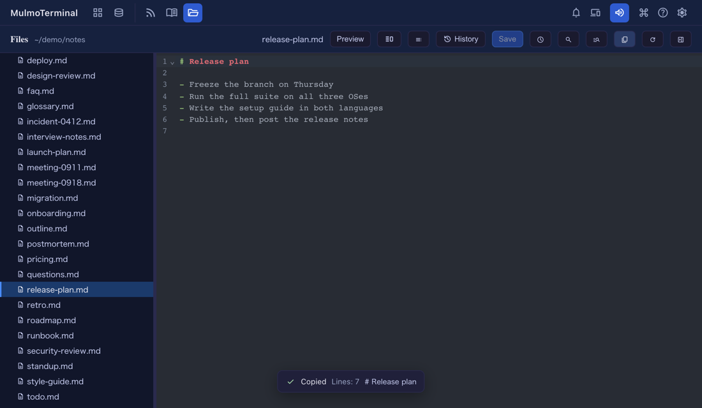
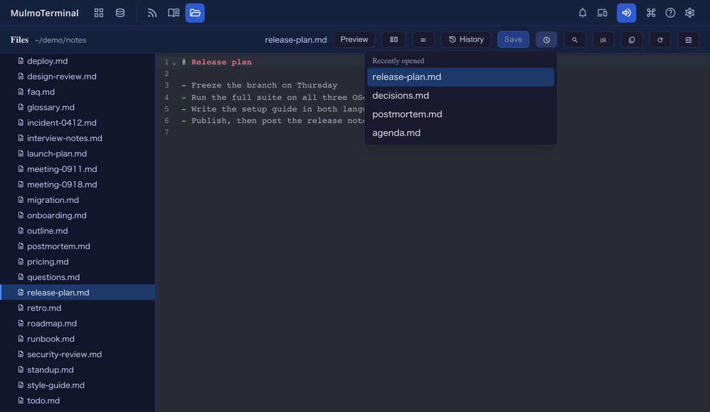

# 10.7.0 — ファイルをまるごとコピー、開いているファイルが分かる、最近開いたファイルを開き直す

**10.7.0 時点（2026-10-16 公開）の記録です。** アプリが進むにつれて古くなります。それは想定どおりで、
最新の説明は各節のリンク先のガイドにあります。

ここに書いたことは、どれも **Files** の画面の話です。ターミナルの横に開くファイルのツリーとエディタ、
またはヘッダーの Files ボタンから全画面で開くものです。設定は何も要りません。

## 新機能

### ボタン 1 つでファイルをまるごとコピー

Files のヘッダーに、**コピー** のボタン（紙が 2 枚重なったアイコン）が付きました。押すと、開いている
ファイルの本文がまるごとクリップボードに入ります。入るのはエディタにある内容で、まだ保存していない
編集も含みます。下に小さな知らせが出て、コピーした行数と 1 行目を見せます
（[#3060](https://github.com/receptron/mulmoterminal/pull/3060)、
[#3058](https://github.com/receptron/mulmoterminal/issues/3058)）。

このボタンがある理由: マウスで選んでコピーすると、本文がそのまま取れないことがありました。
行番号の列からドラッグを始めると、本文ではなく行番号がコピーされます。ボタンは本文そのものを
コピーします。

試し方: Files の画面で何かファイルを開き、コピーのボタンを押して、別の場所に貼り付けます。

ページがクリップボードを使えないときは、ボタンは出ません。別のマシンから `http://`（LAN のアドレス）で
MulmoTerminal を開いているときがそれにあたります。

参考: [機能リファレンス](features.html)。

### 「最近開いたファイル」から開き直す

Files のヘッダーの **時計** のボタンで、このフォルダで開いたファイルを新しい順に並べます。今開いている
ファイルには印が付きます。選ぶとそのファイルがまた開きます。ずっと前にタブを閉じたファイルでも開けます
（[#3062](https://github.com/receptron/mulmoterminal/pull/3062)）。

- 一覧は **フォルダごと**、**このブラウザに** 残ります。読み込み直しても消えませんが、別のパソコンや
  別のブラウザには引き継がれません。
- 隣の **履歴** のボタンとは **別のもの** です。履歴は、開いている 1 つのファイルの以前の *版* を
  並べます。最近開いたファイルは、*どのファイルを* 開いていたかを並べます。ボタンの説明文にも
  そう書いてあります。

試し方: ファイルを 2〜3 個開いて、そのタブを閉じてから、時計のボタンを押します。

参考: [機能リファレンス](features.html)。

## 画面の変化

- **開いているファイルが、ファイルのツリーではっきり分かるようになりました。** その行に「選択中」の色と、
  左端の青い線が付きます（上の 2 枚の画像の `release-plan.md`）。以前も印を付ける作りでしたが、
  実際には一度も表示されていませんでした。そのため、ファイルの多いフォルダでは、どれを開いているか
  分かりませんでした（[#3061](https://github.com/receptron/mulmoterminal/pull/3061)）。
- Files の画面が戻ってきたとき（開き直したとき、ページを読み込み直したとき）、開いているファイルの
  フォルダが開いていれば、その行が見える位置までツリーがスクロールします。閉じていたフォルダは
  閉じたままです。
- 同じ「表示されない強調」が、ほかに 2 か所ありました。**設定** の画面で選んでいるタブと、メニューを
  開いているあいだのツールバーのボタンです。どちらも表示されるようになりました。
- Files のヘッダーに、コピーのボタンと時計のボタンが増えました（上を参照）。

## 見えない変化

- 依存パッケージを更新しました（[#3063](https://github.com/receptron/mulmoterminal/pull/3063)）。
  することはありません。
- 読み上げソフト向け: Files のヘッダーのメニュー（履歴・見出し一覧・最近開いたファイル）と、名前で探す
  一覧に、それぞれ別の id を付けました。Files の画面を 2 つ開いていても、各ボタンが自分の一覧を指します。
- 何もする必要はありません。
