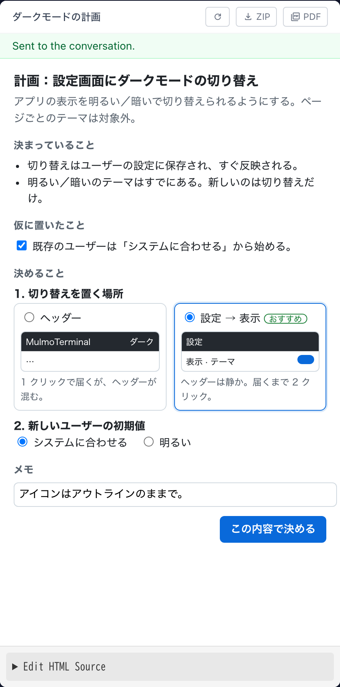

# 11.3.0 — 計画をページで決める

**11.3.0 時点（2026-10-22 リリース）のスナップショットです。** アプリが変わるにつれて古くなります。
それは想定どおりで、最新の説明は各節からリンクしているガイドにあります。

## 新機能

### 計画をページの上で決める

文章で長い計画を読む代わりに、見て選べる計画を頼めるようになりました
（[#3163](https://github.com/receptron/mulmoterminal/pull/3163)、
[#3168](https://github.com/receptron/mulmoterminal/pull/3168)）。たとえば：

> この変更を HTML で計画して

同梱スキル `mulmoterminal-html-plan` が、計画を Canvas（端末の右側のペイン）にページとして出します。
決まっていること、エージェントが仮に置いたこと（違っていればチェックを外せます）、まだ決まっていない
選択肢が、見比べられる小さなモックや操作できる部品として並びます。選んで、調整して、メモを書き、
ページの一番下のボタンを押してください。**Sent to the conversation** と短く出て、決めた内容があなたの
次のメッセージとして端末に届き、エージェントがそこから続けます。

Canvas が開いていないときは、セルの見出しに件数付きの鉛筆のボタンが出ます。それを押すか、セルの
ツールメニュー（レンチ）から **キャンバス** を選んでください。

詳しくは：[機能](features.html)。

### 動画を頼んで編集する

一部の切り出し、つなぎ、速さの変更、音量をそろえる・差し替える、縦長にする、話している内容から
字幕を作る、題名を画面に入れる、をエージェントに頼めるようになりました
（[#3160](https://github.com/receptron/mulmoterminal/pull/3160)）。同梱スキル
`mulmoterminal-video-edit` が `ffmpeg`（`brew install ffmpeg`）で行います。話から字幕を作るときは
`whisper-cli`（`brew install whisper-cpp`）も使います。元の動画は変えず、結果は隣に新しいファイルとして
書き出してペインに開きます。

詳しくは：[機能](features.html)。

## 画面の変化

- エージェントの計画ページではないページ（たとえば既存のファイルを開いたもの）は、ボタンを押すと、
  送る内容がそのままページの上の欄に出ます。その欄の **Send** を押したときだけ送られます
  （[#3163](https://github.com/receptron/mulmoterminal/pull/3163)）。
- ワードクラウドを専用のライブラリで描くようになりました。形（円、星、ひし形など）を選べます。
  書き出しは PNG だけになり、SVG にはできなくなりました
  （[#3164](https://github.com/receptron/mulmoterminal/pull/3164)、
  [#3165](https://github.com/receptron/mulmoterminal/pull/3165)）。
- 表計算のガイドに、グラフと表を返す計算式の見た目の例が載りました
  （[#3161](https://github.com/receptron/mulmoterminal/pull/3161)）。

## 見えない変化

### グラフの修正

表の範囲から描いた地図で、データの無い地域がいちばん大きい値の色で塗られていたのを直しました。
暗いテーマで 3D のグラフの軸の文字が読めるようになりました
（[#3164](https://github.com/receptron/mulmoterminal/pull/3164)）。することはありません。

### ライブラリの更新

グラフ、HTML ページ、共通部分のライブラリを更新しました
（[#3164](https://github.com/receptron/mulmoterminal/pull/3164)、
[#3165](https://github.com/receptron/mulmoterminal/pull/3165)、
[#3168](https://github.com/receptron/mulmoterminal/pull/3168)）。clone から動かしている場合は、pull の
あとに `yarn install` を実行してください。しないと、計画ページのボタンが確認の欄を経由する動きに戻ります。
