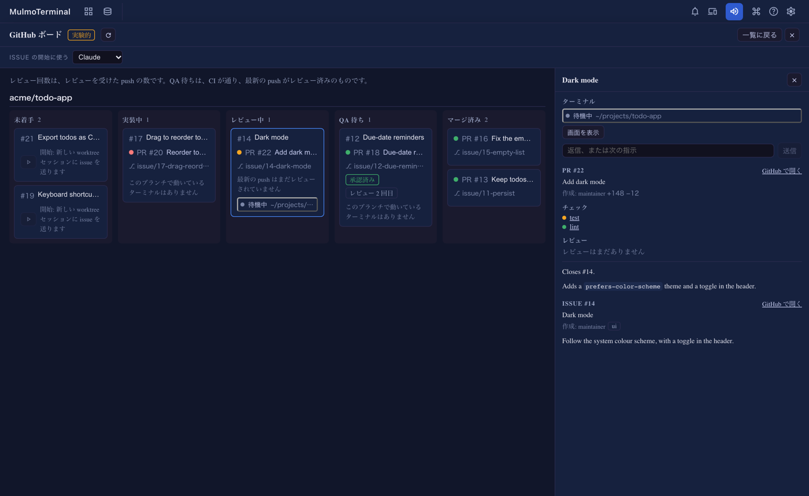
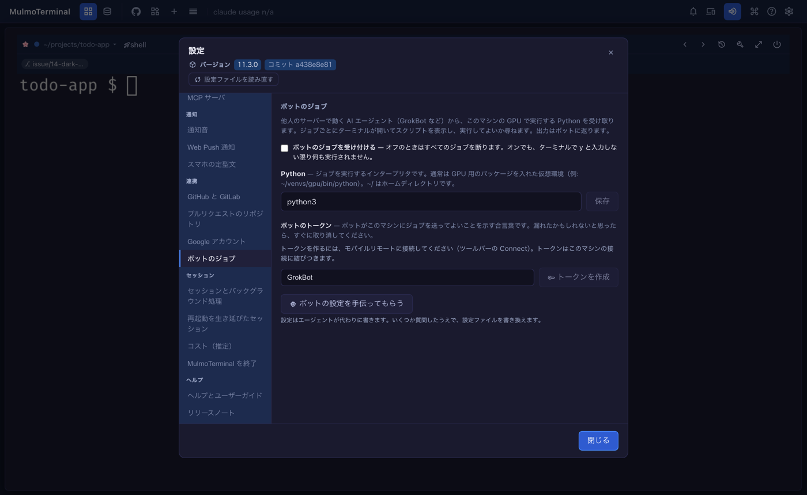

# 11.4.0 — issue と PR をボードで見る

**11.4.0 時点（2026-10-26 リリース）のスナップショットです。** アプリが変わるにつれて古くなります。
それは想定どおりで、最新の説明は各節からリンクしているガイドにあります。

## 新機能

### GitHub ボード（試験的）

GitHub の画面（ツールバーの GitHub マーク）を開き、**ボードを開く（実験的）** を押してください
（[#3175](https://github.com/receptron/mulmoterminal/pull/3175)）。**設定 → プルリクエストのリポジトリ**
に登録したリポジトリごとに、作業 1 つが 1 枚のカードになり、**未着手**・**実装中**・**レビュー中**・
**QA 待ち**・**マージ済み** の 5 列のどこかに並びます。カードには、issue、それを閉じるプルリクエスト、
ブランチ、そのブランチで開いているターミナルがまとめて載ります。

カードがどの列に入るか：

- **実装中** — 下書き、CI の失敗、修正の依頼のどれかがあるもの。または、ターミナルが開いていて
  プルリクエストがまだ無いブランチ。
- **レビュー中** — CI が走っている途中か、最新の push がまだレビューされていないもの。カードの
  **レビュー 2 回目** は、レビューを受けた push が 2 つあるという意味です。
- **QA 待ち** — CI が通り、最新の push がレビュー済みのもの（または承認済みのもの）。

カードを押すと、右に詳細が開きます。そのカードのターミナル、プルリクエストのチェックとレビューと説明、
issue のラベルと説明が出ます。**GitHub で開く** はこの中にあります
（[#3178](https://github.com/receptron/mulmoterminal/pull/3178)）。

**ボードから issue を始める。** 未着手のカードには開始のボタンがあります。押すと、issue の worktree を
作り、**ISSUE の開始に使う** で選んだエージェントを起動して、issue の本文をすぐに送ります。新しい
ターミナルはボードの裏のグリッドに加わり、カードは実装中に移ります
（[#3181](https://github.com/receptron/mulmoterminal/pull/3181)）。`/github` の一覧から始めたときは、
これまでどおり本文を送るのはあなたです。

**ボードからターミナルに答える。** 詳細のターミナルごとに **画面を表示** と、**返信、または次の指示**
の欄があります。欄に書くと 1 行を打ち込んで Enter を押します
（[#3187](https://github.com/receptron/mulmoterminal/pull/3187)）。そのターミナルにすでに打ちかけていた
文字は消えません。Claude のターミナルが選択肢つきの質問をしていて、質問ペインがオンなら、選択肢が
ボタンで出ます。許可の確認（1. Yes / 2. No）はキー操作が要るので、ターミナルを開いて答えてください。

**開いている間は自動で新しくなります**（[#3183](https://github.com/receptron/mulmoterminal/pull/3183)）。
ターミナルの状態（作業中・確認待ち・待機中）はその場で変わり、あなたの返事を待っているターミナルの
あるカードは、琥珀色の枠と **確認待ち** の印で目立ちます。ボードが画面に出ている間は 1 分ごとに、
またターミナルの 1 ターンが終わった数秒後に、GitHub を読み直します。読み直しに失敗しても、カードは
そのまま残り、上にエラーが出ます。

GitHub のリポジトリだけが対象で、一覧と同じく `gh` へのログインが要ります。詳しくは：
[GitHub](github.html)。

### リモートのボットに Python のジョブを動かしてもらう

他人のサーバーで動く AI エージェント（GrokBot など）が、Python のスクリプトをこのマシンに送って
（たとえば GPU で）動かし、出力を受け取れるようになりました
（[#3184](https://github.com/receptron/mulmoterminal/pull/3184)、
[#3192](https://github.com/receptron/mulmoterminal/pull/3192)）。**あなたが許さない限り何も動きません。**
ジョブごとにターミナルが開き、スクリプトと実際のコマンドを見せたうえで `Run this job? [y/N]` と
尋ねます。`y` と打ったときだけ実行します。

設定は **設定 → 連携 → ボットのジョブ** で行います。

1. **ボットのジョブを受け付ける** にチェックを入れます。入れるまでは、すべてのジョブを断ります。
2. **Python** に、ジョブを動かすインタープリタを書いて **保存** を押します。通常は GPU 用のパッケージを
   入れた仮想環境（例: `~/venvs/gpu/bin/python`）です。
3. モバイルリモートに接続します（ツールバーの **Connect**）。トークンはこのマシンの接続に結びつくので、
   接続するまで **トークンを作成** は押せません。
4. ボットの名前を書いて **トークンを作成** を押します。秘密の文字列は **一度だけ** 表示され、コピーの
   ボタンと、ボットに渡す 2 つのアドレスも一緒に出ます。その場でコピーしてください。あとからは出せません。

どの Python に必要なパッケージが入っているかわからないときは、**ボットの設定を手伝ってもらう** を
押すと、エージェントが探して設定を書いてくれます。漏れたかもしれないトークンは、同じ一覧からすぐに
取り消してください。

ジョブのターミナルは、ブラウザのタブを開いていなくても開き、ジョブが終わるまで残ります。詳しくは：
[スマホ](phone.html)。

## 画面の変化

- 共有プラグインの画面（Canvas のページの確認の欄や「Sent to the conversation」、markdown、グラフなど）
  が、いつも英語ではなく、アプリの表示言語で出るようになりました。コレクションと会計も、ブラウザの
  言語ではなくアプリで選んだ表示言語に従います
  （[#3171](https://github.com/receptron/mulmoterminal/pull/3171)）。
- 別のマシンから、設定していない名前やアドレスで MulmoTerminal を開くと、どのリクエストも `403` で
  断られ、足すべき設定の名前が出るようになりました。これまでは、ページは開くもののターミナルが
  つながりませんでした（[#3191](https://github.com/receptron/mulmoterminal/pull/3191)）。
  [見えない変化](#server-name) も見てください。

## 見えない変化

### 絵文字や全角の文字で行がずれない

絵文字、国旗、肌の色、家族の絵文字、ハングルを含む行で、それより右がブラウザで 1 文字ずれることが
ありました。その文字の幅を、ブラウザと tmux が違うように数えていたためです。サーバーの起動時に、
動いている tmux が各文字を何文字分と数えるかを測り、ブラウザも同じに数えるようにしました
（[#3174](https://github.com/receptron/mulmoterminal/pull/3174)）。測り終える前に開いていたタブも、
結果が届いた時点で直して描き直します
（[#3186](https://github.com/receptron/mulmoterminal/pull/3186)、
[#3190](https://github.com/receptron/mulmoterminal/pull/3190)）。Windows では psmux について同じことを
します（[#3193](https://github.com/receptron/mulmoterminal/pull/3193)）。結合した文字がとても長く続く
ときも、tmux と同じ位置で折り返します
（[#3195](https://github.com/receptron/mulmoterminal/pull/3195)）。することはありません。すでにずれていた
ターミナルは、サーバーを再起動すると揃います。

### サーバーが答える名前 {#server-name}

リクエストは、`localhost` か、`MULMOTERMINAL_HOST` または `MULMOTERMINAL_ALLOWED_ORIGINS` に設定した名前
あてでなければ受け付けなくなりました（[#3191](https://github.com/receptron/mulmoterminal/pull/3191)）。
DNS の仕掛け（DNS rebinding）で、ほかのウェブページが MulmoTerminal を読むのを防ぐためです。同じマシンで
開く場合や、`localhost` へのトンネル越しに開く場合は何も変わりません。`0.0.0.0` で待ち受けて LAN の
アドレスで開いている場合は、そのアドレスを `MULMOTERMINAL_ALLOWED_ORIGINS` に足してください。詳しくは：
[設定](config.html#bind-host)。

### psmux のメモリが減る

Windows で psmux 3.3.1 以降を使っている場合、psmux が予備に持っておくシェルを止めます。新しいサーバーも、
動いているサーバーも対象です（[#3169](https://github.com/receptron/mulmoterminal/pull/3169)）。どのセルも
予備を使わないので、メモリを使い、大きさが変わるたびに作り直されていただけでした。することはありません。

### ライブラリの更新

jinglescript のプラグイン、表計算のプラグイン、Gemini と MCP のライブラリなどを更新しました
（[#3176](https://github.com/receptron/mulmoterminal/pull/3176)）。clone から動かしている場合は、pull の
あとに `yarn install` を実行してください。
